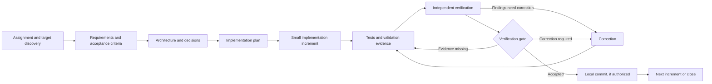

# Autonomous Engineering Harness

Repository: `autonomous-engineering-harness`

A reusable foundation for working through software assignments in an existing or new target repository. It defines an evidence-based engineering lifecycle, review contracts, quality gates, reusable project-document templates, and a read-only target preflight CLI. It is designed to be language- and architecture-neutral.

The current release provides a **Codex operating procedure and a read-only target preflight CLI**. Prompt 06 is the canonical task entrypoint; it instructs the primary Codex session to carry an assignment through all authorized increments and closeout. This remains an instruction-driven procedure, not an executable orchestrator, write broker, state store, or automatic policy evaluator. Required independent review and gate authorities must be operationally available under the policy; the primary implementation session cannot replace them.

## Repository boundary

Use this repository for reusable instructions and process assets. Use a separate target repository for the actual product, its requirements, code, tests, migrations, deployment files, and project-specific evidence. At the beginning of an engagement, identify the target path and read its instructions. Do not copy product files into this repository.

## Lifecycle



## Start here

1. Give Codex the task and the **absolute repository-root path** of the target. If the target path is missing or ambiguous, Codex must ask for it; it never guesses from the harness working directory.
2. Use [prompt 06](harness/prompts/06-autonomous-single-agent.md) as Codex's top-level operating instruction. The primary Codex session owns discovery, requirements, planning, implementation, validation, corrections, gate coordination, and closeout. It uses prompts `00`–`05` as phase procedures and continues through the planned increments without routine approval requests.
3. Codex runs the [read-only preflight](#read-only-target-preflight), reads the target's instructions and conventions, and derives and records narrow per-increment code and artifact scopes from the authorized task before writing. Product records stay in the target. If the target has no workflow-state convention, the default is `.engineering/workflows/<workflow_id>/workflow-state.json`; related workflow evidence and reports are kept in that workflow directory. Existing target conventions take precedence.
4. When policy permits an agent-session review, a separate read-only Codex session receives the exact revision, scope, instructions, and evidence. The primary session handles findings and corrections. This does not replace authenticated human reviewers or gate approvers required for High-risk work. If a required session or authority is unavailable, Codex records the blocked phase and does not claim completion.

See the [workflow guide](docs/workflow.md), [engineering lifecycle](harness/workflows/engineering-lifecycle.md), [verification framework](docs/verification-framework.md), [reviewer contracts](harness/verification/reviewer-contracts.md), [gate policy](harness/gates/verification-gate.md), and [authorization policy](harness/config/verification-policy.yaml) for the detailed boundaries and phase conditions.

## Contents

- `harness/workflows/`: lifecycle and operating procedure.
- `harness/prompts/`: phase prompts `00`–`05` and canonical top-level single-agent entrypoint `06`.
- `harness/verification/`: reviewer contracts and evidence rules.
- `harness/gates/`: stage-gate policy.
- `harness/schemas/`: JSON Schema contracts for workflow state, traceability, evidence, findings, and gate decisions.
- `harness/preflight.py`: dependency-free read-only target identity, isolation, state, instruction, scope, and filesystem inspection.
- `harness/schemas/preflight-config.schema.json`: optional JSON input contract for preflight scopes and instruction roots.
- `harness/config/`: default verification policy.
- `harness/templates/`: starting points for target-repository documents.
- `docs/`: architecture, workflow, decisions, and generalized lessons.

## Read-only target preflight

Run from any working directory with an explicit repository-root target:

```sh
./harness/preflight.py --target /absolute/path/to/target
```

Optional scope and instruction-root configuration is JSON. An omitted or empty `included_paths` list authorizes zero writes. `--workspace-root` explicitly authorizes inspection of the direct ancestor instruction chain; without it, preflight does not read above the target root.

```sh
./harness/preflight.py \
  --target /absolute/path/to/target \
  --workspace-root /absolute/path/to/workspace \
  --config /absolute/path/to/preflight.json
```

The config may contain `target_path`, `workspace_root`, `instruction_roots`, `authorized_working_directories`, `included_paths`, `code_paths`, `artifact_paths`, `revision_paths`, and `excluded_paths`. The CLI requires Python 3.10+ and uses only the standard library plus the Git executable. It prints a structured JSON report; exit codes are `0` for `READY`, `2` for `BLOCKED`, and `3` for `NEEDS_HUMAN_INPUT`. Individual check records classify invalid input separately from unsafe conditions and human-input requirements.

Example scope config:

```json
{
  "included_paths": ["src", "docs"],
  "code_paths": ["src"],
  "artifact_paths": ["docs"],
  "revision_paths": ["src", "docs"],
  "excluded_paths": []
}
```

Preflight verifies Git identity and separation from the harness, reads repository state, inventories instructions/capabilities and documentation locations, validates configured scopes, and observes symlinks, hard links, and filesystem identity. It never writes to the target, executes discovered instructions, installs tools, or contacts external services. A `READY` report means these read-only checks passed for the observed state. It does not enforce safety for future writes: a future writer must revalidate paths and inode/link identity at the operation boundary and must provide race-safe containment. Ancestor instruction reads occur only for roots explicitly supplied through `--workspace-root` or `instruction_roots`.

The standard-library test suite runs with `python3 -m unittest discover -s tests -v`.

## Current limitations

The operating procedure and policy describe controls but do not technically enforce them. The preflight CLI enforces its own read-only inspection contract; there is no executable engineering orchestrator, write broker, persistent state store, identity provider, CI integration, Draft 2020-12 schema validator, cross-record evidence/revision validator, or automatic policy evaluator. Independent Codex sessions and required human reviewers/approvers must be available through the host environment; the prompt cannot create those capabilities. Report attestations cannot prove substantive reviewer exhaustiveness.

## Roadmap

See [PLANS.md](PLANS.md) for planned increments and completion boundaries. Suggestions and implementation ideas should remain distinct from approved commitments.
