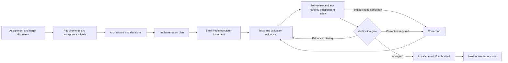

# Autonomous Engineering Harness

Repository: `autonomous-engineering-harness`

A reusable foundation for working through software assignments in an existing or new target repository. It defines an evidence-based engineering lifecycle, review contracts, quality gates, reusable project-document templates, and a read-only target preflight CLI. It is designed to be language- and architecture-neutral.

The current release provides an **executable Codex task launcher, the single-session operating procedure, a read-only target preflight CLI, and a bounded Claude-through-Aily reviewer adapter**. The launcher runs one primary `codex exec` session with Prompt 06 and the immutable policy, and checks that the target records a completed `APPROVE` gate before returning success. Codex still performs the lifecycle phases and persists target workflow state; the launcher is not a stage-by-stage execution engine, scoped write broker, or automatic policy evaluator. The adapter can support policy-required Medium-risk read-only review after target-specific external-service authorization has been verified. Self-review and reviewer recommendations are not gate approval. High-risk human review and approval authorities remain required; unavailable reviewers or gate authorities leave the workflow incomplete or blocked.

## Repository boundary

Use this repository for reusable instructions and process assets. Use a separate target repository for the actual product, its requirements, code, tests, migrations, deployment files, and project-specific evidence. At the beginning of an engagement, identify the target path and read its instructions. Do not copy product files into this repository.

## Lifecycle



## Start here

1. Start a Codex session with this repository's `AGENTS.md` instructions available. Give Codex the task and the **absolute repository-root path** of the target. If the target path is missing or ambiguous, Codex must ask for it; it never guesses from the harness working directory.
2. Start a task from a shell with the executable entrypoint below. It requires an authenticated local Codex CLI. The runner performs read-only preflight, starts one ephemeral Codex session in the target-root `workspace-write` sandbox, supplies Prompt 06 and the policy, and validates the final target workflow-state gate. Codex remains the phase orchestrator; use Prompt 06 directly when already working in a primary Codex session.

```sh
python3 /absolute/path/to/autonomous-engineering-harness/harness/runner.py \
  --target /absolute/path/to/target-repository \
  --task-file /absolute/path/to/task.md
```

The workflow ID is stable for the same canonical target and task text. If a run is interrupted, rerun the same command; pass `--workflow-id ID` when the task text changes or the ID must be selected explicitly. The launcher returns success only when target state records `status=COMPLETED`, `phase=COMPLETED`, a valid `content:<sha256>` revision, final evidence IDs, and `gate_outcome=APPROVE`. A missing or incomplete state is a blocker. It does not bypass operation-specific approvals for branches, commits, pushes, PRs, deployments, or external services.

When the assignment explicitly authorizes a bounded Claude/Aily review, pass an aggregate ceiling such as `--claude-budget-usd 2`. The launcher forwards the limit to the review process. The adapter clamps each Aily call to the remaining aggregate amount and stops if a previous attempted call has no recorded cost.
3. Codex runs the [read-only preflight](#read-only-target-preflight), reads the target's instructions and conventions, and derives and records narrow per-increment code and artifact scopes from the authorized task before writing. Product records stay in the target. If the target has no workflow-state convention, the default is `.engineering/workflows/<workflow_id>/workflow-state.json`; related workflow evidence and reports are kept in that workflow directory. Existing target conventions take precedence.
4. The primary session performs structured self-review using the applicable reviewer contracts, fixes in-scope findings, and reruns affected checks. For Medium-risk work, it may use the Claude adapter after explicit user task-prompt authorization is persisted with exact target, reviewer, data paths, cost, and mutation terms. Record identity as declared when the runtime cannot establish stronger assurance; this provenance is not authentication. The adapter validates persisted authorization and evidence and runs from a bounded read-only snapshot; its report is advisory. High-risk human review, second-review, and gate-approval requirements remain. If a required reviewer or authority is unavailable, Codex records the incomplete/blocked phase and does not claim completion.

Use the [new-task guide and reusable prompt template](docs/workflow.md#start-a-new-task-with-codex) to provide a request. Codex should continue autonomously on authorized, in-scope work and ask only about material ambiguity, restricted-operation authorization, required human approval, or a genuine blocker.

See the [workflow guide](docs/workflow.md), [engineering lifecycle](harness/workflows/engineering-lifecycle.md), [verification framework](docs/verification-framework.md), [reviewer contracts](harness/verification/reviewer-contracts.md), [gate policy](harness/gates/verification-gate.md), and [authorization policy](harness/config/verification-policy.yaml) for the detailed boundaries and phase conditions.

## Contents

- `harness/workflows/`: lifecycle and operating procedure.
- `harness/prompts/`: phase prompts `00`–`05` and canonical top-level single-agent entrypoint `06`.
- `harness/verification/`: reviewer contracts and evidence rules.
- `harness/gates/`: stage-gate policy.
- `harness/schemas/`: JSON Schema contracts for workflow state, traceability, evidence, findings, and gate decisions.
- `harness/preflight.py`: dependency-free read-only target identity, isolation, state, instruction, scope, and filesystem inspection.
- `harness/runner.py`: explicit-target Codex CLI launcher with preflight and final-gate completion checks.
- `harness/safe_writer.py`: narrow scope-checked target directory creation and file creation/replacement helper; re-runs preflight and emits JSON operation evidence under the documented single-writer assumption.
- `harness/claude_reviewer.py`: bounded Aily/Claude read-only review invocation, evidence and manifest validation, one-shot persisted two-round enforcement, isolated snapshot, report validation, and review-evidence mapping. Explicit user authorization can be persisted with declared identity assurance when external identity is unavailable.
- `harness/schemas/preflight-config.schema.json`: optional JSON input contract for preflight scopes and instruction roots.
- `harness/config/`: default verification policy.
- `harness/templates/`: starting points for target-repository documents.
- `docs/`: architecture, workflow, decisions, and generalized lessons.

## Read-only target preflight

Run from any working directory with an explicit repository-root target:

```sh
./harness/preflight.py --target /absolute/path/to/target
```

Optional scope and instruction-root configuration is JSON. An omitted or empty `included_paths` list authorizes zero writes. `--workspace-root` explicitly authorizes inspection of the direct ancestor instruction chain; without it, preflight does not read above the target root.

```sh
./harness/preflight.py \
  --target /absolute/path/to/target \
  --workspace-root /absolute/path/to/workspace \
  --config /absolute/path/to/preflight.json
```

The config may contain `target_path`, `workspace_root`, `instruction_roots`, `authorized_working_directories`, `included_paths`, `code_paths`, `artifact_paths`, `revision_paths`, and `excluded_paths`. The CLI requires Python 3.10+ and uses only the standard library plus the Git executable. It prints a structured JSON report; exit codes are `0` for `READY`, `2` for `BLOCKED`, and `3` for `NEEDS_HUMAN_INPUT`. Individual check records classify invalid input separately from unsafe conditions and human-input requirements.

Example scope config:

```json
{
  "included_paths": ["src", "docs"],
  "code_paths": ["src"],
  "artifact_paths": ["docs"],
  "revision_paths": ["src", "docs"],
  "excluded_paths": []
}
```

Preflight verifies Git identity and separation from the harness, reads repository state, inventories instructions/capabilities and documentation locations, validates configured scopes, and observes symlinks, hard links, and filesystem identity. It never writes to the target, executes discovered instructions, installs tools, or contacts external services. A `READY` report means these read-only checks passed for the observed state. It does not itself enforce future writes; `harness/safe_writer.py` re-runs preflight for each write and revalidates the exact path through no-follow directory descriptors. Ancestor instruction reads occur only for roots explicitly supplied through `--workspace-root` or `instruction_roots`.

## Scope-checked target writes

Use the safe writer with the same JSON scope configuration used by preflight. It accepts bytes on standard input and only writes a path covered by exactly one authorized code or artifact prefix:

```sh
python3 harness/safe_writer.py mkdir \
  --target /absolute/path/to/target \
  --config /absolute/path/to/preflight.json \
  --path src/new-module/types

python3 harness/safe_writer.py create \
  --target /absolute/path/to/target \
  --config /absolute/path/to/preflight.json \
  --path src/new-file.py < /path/to/new-content

python3 harness/safe_writer.py replace \
  --target /absolute/path/to/target \
  --config /absolute/path/to/preflight.json \
  --path src/existing-file.py \
  --expected-sha256 SHA256_RECORDED_BEFORE_EDIT < /path/to/replacement-content
```

`mkdir` creates missing path components one at a time with exclusive directory creation. Every missing component must independently pass the explicit write-scope and code/artifact classification checks; a scope for a nested leaf does not authorize creating an out-of-scope parent. Existing components are opened with no-follow directory descriptors and are not replaced or directly changed. If the requested directory already exists, the operation fails. A later filesystem error leaves earlier directories in place and returns partial JSON evidence; inspect that evidence before retrying. Creating a child necessarily updates its existing parent directory's filesystem timestamps, while preserving the parent's identity, mode, ownership, and existing entries.

Creation uses `O_EXCL` and never overwrites an existing entry. Replacement requires the expected baseline SHA-256 recorded before implementation, rejects symlinks and files with multiple hard links, writes and fsyncs a temporary file in the verified destination directory, checks the original path/descriptor identity and content immediately before an atomic rename, fsyncs the directory, then verifies the resulting hash and identity. The JSON response contains the operation, path, before/after identities and hashes, and link count; retain it with the target workflow evidence. The helper preserves POSIX mode and owner/group where permitted; it does not preserve extended attributes or ACLs, so do not use it on files whose correctness depends on those metadata.

The replacement rename is atomic for readers, but macOS does not condition it on the destination inode checked immediately beforehand. The workflow therefore assumes one Codex writer and requires humans and automation to pause edits during that workflow. This is not protection against arbitrary non-cooperating writers racing after the final check. Stop and revalidate if an unexpected modification is observed. A process crash during exclusive creation may leave a partial new file; inspect and resolve it before retrying.

The standard-library test suite runs with `python3 -m unittest discover -s tests -v`.

## Current limitations

The launcher delegates phase orchestration to one Codex session; it does not implement a separate transition engine, state store, command broker, identity provider, CI integration, or cross-record policy evaluator. Its Codex sandbox is scoped to the target repository root and an ephemeral tool snapshot; per-increment write scopes remain enforced by safe-writer invocations and workflow contracts, not a per-path Codex sandbox. The snapshot is verified by hash after the run. The safe writer relies on the single-writer assumption and does not preserve ACLs/extended attributes. The Claude adapter validates target/workflow/reviewer/data-specific authorization attestations, evidence artifacts, scoped manifests, one-shot round claims, and workflow history. When a total budget is supplied through `max_budget_usd` or `HARNESS_CLAUDE_TOTAL_BUDGET_USD`, it clamps Aily's `--max-budget-usd` to the remaining amount and blocks another call if earlier spend is unknown. Without a supplied limit, no monetary ceiling is enforced. The adapter records declared identity when the runtime lacks authenticated user identity and does not claim cryptographic proof. Its temporary snapshot plus Claude Code `--restricted`, no-MCP configuration, and read-only tool allowlist constrain file tools to the authorized snapshot; this is not an OS sandbox around the Aily/Claude process. Human identities and approvals required by High-risk policy still need trusted authentication. The workflow owner must compute the complete workflow `revision_paths` identity for the gate. The isolated demo completed implementation, tests, self-review, and preflight, but the actual Aily call failed before producing a report because the sandbox could not create a temporary file under `~/.cache/uv`; no Claude review or approved gate was recorded. The first standalone Codex CLI probe also returned 401 without a bearer token, while the final runner invocation succeeded after the normal local filesystem permission escalation.

## Roadmap

See [PLANS.md](PLANS.md) for planned increments and completion boundaries. Suggestions and implementation ideas should remain distinct from approved commitments.
