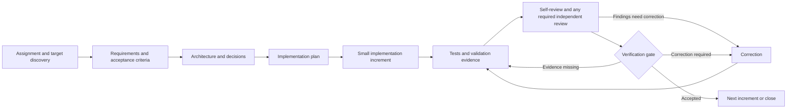

# Autonomous Engineering Harness

Repository: `autonomous-engineering-harness`

A reusable foundation for working through software assignments in an existing or new target repository. It defines an evidence-based engineering lifecycle, review contracts, quality gates, reusable project-document templates, and a read-only target preflight CLI. It is designed to be language- and architecture-neutral.

The current workflow uses **one workspace-scoped execution policy, a read-only target preflight, Safe Writer, and a bounded Claude-through-Aily reviewer adapter**. `harness/orchestrator.py` is the sole supported workflow execution entrypoint. At initialization it records a versioned policy bound to the canonical target and workflow ID. That policy covers ordinary assignment-related file operations, configured development commands, approved project dependency installation, workflow evidence, local Git inspection and exact-path staging, internal transitions, and bounded review corrections. Codex child sessions are read-only and return structured file changes; the controller applies them through Safe Writer. `harness/runner.py` is deprecated and retained only as legacy compatibility code. The orchestrator does not implement the complete cross-record verification gate evaluator or commits, pushes, merges, publication, or PRs. Required authenticated High-risk review and gate authority remain external.

## Repository boundary

Use this repository for reusable instructions and process assets. Use a separate target repository for the actual product, its requirements, code, tests, migrations, deployment files, and project-specific evidence. At the beginning of an engagement, identify the target path and read its instructions. Do not copy product files into this repository.

## Lifecycle



## Start here

1. Start a Codex session with this repository's `AGENTS.md` instructions available. Give Codex the task and the **absolute repository-root path** of the target. If the target path is missing or ambiguous, Codex must ask for it; it never guesses from the harness working directory.
2. Start the task with `harness/orchestrator.py` using an absolute target, exact branch, task file, and a configuration containing inspected validation commands. The controller launches Codex using `--sandbox read-only` for each plan, implementation, and correction stage; the outer controller is the only process that writes target files, using Safe Writer under the persisted workspace policy. See [the orchestrator guide](docs/orchestrator.md) for the full command and configuration. Use Prompt 06 only for an already active interactive Codex session; it does not replace the orchestrator as a workflow engine.

The workflow ID is stable for the same canonical target, task text, branch, and configuration. If a run is interrupted, rerun the same orchestrator command with the same `--workflow-id`; it resumes from persisted target-local state when no genuine product decision blocks the phase. The workspace execution policy is reused on resume. Functional decisions can be inspected with `--list-pending-decisions` and answered with `--respond-decision`; those responses cannot authorize external operations or satisfy authenticated High-risk approvals.
3. The orchestrator runs read-only preflight, reads target instructions and conventions, and records the workspace policy before making changes. Product records stay in the target. If the target has no workflow-state convention, the default is `.engineering/workflows/<workflow_id>/workflow-state.json`; related workflow evidence and reports are kept in that workflow directory. `revision_paths` describe what reviewers inspect and are not write allowlists.
4. The controller runs self-review, configured validations, and then Claude through Aily when the workflow config carries a valid, explicitly authorized review grant covering the repository, exact review files, read-only mode, exclusions, validity period, and budget. Missing or invalid authorization pauses before external contact. The adapter reviews a bounded read-only snapshot; Codex processes findings, corrects accepted issues, self-reviews again, and reruns affected validations. Review authorization is distinct from human review or gate approval. Required authenticated High-risk human review and gate authority remain.

Use the [new-task guide and reusable prompt template](docs/workflow.md#start-a-new-task-with-codex) to provide a request. Codex should continue autonomously on authorized, in-scope work and ask only about material ambiguity, restricted-operation authorization, required human approval, or a genuine blocker.

See the [workflow guide](docs/workflow.md), [engineering lifecycle](harness/workflows/engineering-lifecycle.md), [verification framework](docs/verification-framework.md), [reviewer contracts](harness/verification/reviewer-contracts.md), [gate policy](harness/gates/verification-gate.md), and [authorization policy](harness/config/verification-policy.yaml) for the detailed boundaries and phase conditions.

## Contents

- `harness/workflows/`: lifecycle and operating procedure.
- `harness/prompts/`: phase prompts `00`–`05` and canonical top-level single-agent entrypoint `06`.
- `harness/verification/`: reviewer contracts and evidence rules.
- `harness/gates/`: stage-gate policy.
- `harness/schemas/`: JSON Schema contracts for workflow state, orchestrator plans/results/configuration, traceability, evidence, findings, and gate decisions.
- `harness/preflight.py`: dependency-free read-only target identity, isolation, state, instruction, scope, and filesystem inspection.
- `harness/orchestrator.py`: bounded stage controller for plan, implement, validate, Claude review, correction, revalidation, and target-local workflow state.
- `harness/runner.py`: deprecated legacy compatibility launcher; not a supported workflow entrypoint.
- `harness/safe_writer.py`: workspace-bound target file operations with retained path, identity, hard-link, and expected-content checks; legacy path-scope mode remains available to standalone callers.
- `harness/claude_reviewer.py`: bounded Aily/Claude read-only review invocation, evidence and manifest validation, one-shot persisted two-round enforcement, isolated snapshot, report validation, and review-evidence mapping. Explicit user authorization can be persisted with declared identity assurance when external identity is unavailable.
- `harness/schemas/preflight-config.schema.json`: optional JSON input contract for preflight scopes and instruction roots.
- `harness/config/`: default verification policy.
- `harness/templates/`: starting points for target-repository documents.
- `docs/`: architecture, workflow, decisions, and generalized lessons.
- `docs/orchestrator.md`: stage-controller CLI, config, resume, and approval boundaries.

## Read-only target preflight

Run from any working directory with an explicit repository-root target:

```sh
./harness/preflight.py --target /absolute/path/to/target
```

Optional scope and instruction-root configuration is JSON. Legacy `included_paths` limits apply only when no workspace execution policy is supplied. The orchestrator uses its persisted policy rather than per-increment path lists. `--workspace-root` explicitly authorizes inspection of the direct ancestor instruction chain; without it, preflight does not read above the target root.

```sh
./harness/preflight.py \
  --target /absolute/path/to/target \
  --workspace-root /absolute/path/to/workspace \
  --config /absolute/path/to/preflight.json
```

The config may contain `target_path`, `workspace_root`, `instruction_roots`, `authorized_working_directories`, `included_paths`, `code_paths`, `artifact_paths`, `revision_paths`, and `excluded_paths`. The CLI requires Python 3.10+ and uses only the standard library plus the Git executable. It prints a structured JSON report; exit codes are `0` for `READY`, `2` for `BLOCKED`, and `3` for `NEEDS_HUMAN_INPUT`. Individual check records classify invalid input separately from unsafe conditions and human-input requirements.

Example scope config:

```json
{
  "included_paths": ["src", "docs"],
  "code_paths": ["src"],
  "artifact_paths": ["docs"],
  "revision_paths": ["src", "docs"],
  "excluded_paths": []
}
```

Preflight verifies Git identity and separation from the harness, reads repository state, inventories instructions/capabilities and documentation locations, validates configured scopes, and observes symlinks, hard links, and filesystem identity. It never writes to the target, executes discovered instructions, installs tools, or contacts external services. A `READY` report means these read-only checks passed for the observed state. Safe Writer re-runs preflight and revalidates workspace binding and path identity through no-follow directory descriptors before each file operation. Ancestor instruction reads occur only for roots explicitly supplied through `--workspace-root` or `instruction_roots`.

## Workspace writes and retained checks

The orchestrator supplies Safe Writer with the workspace policy stored at initialization. Assignment-related source, tests, documentation, configuration, metadata, generated files, and evidence can be created or edited anywhere inside the canonical target without exact path-prefix or extension allowlists. Verified existing directories can be traversed; directory creation no longer requires separate approval for each missing component. Workflow-created files may be renamed or deleted with operation evidence. Preserve pre-existing unrelated user files and changes. Git metadata, nested repositories, credential/environment paths, symlink escapes, and paths outside the target remain excluded. Replacements still verify the expected content and file identity and reject hard links. The standalone helper retains legacy scope-config mode for existing callers.

Normal project commands and approved package-manager installs run through the configured command filter without per-command approval. The filter blocks known shell, external-service, privilege-escalation, publication, direct destructive filesystem, and out-of-workspace command forms and removes credential-like environment variables. Workflow-created files can be removed through Safe Writer. The command filter is a guardrail, not OS-level process confinement; project code can still have side effects as the current user.

The standard-library test suite runs with `python3 -m unittest discover -s tests -v`.

## Current limitations

The command filter is not a substitute for OS-level process confinement. Runtime project scripts may have side effects under the current user account, so configured commands still need ordinary engineering judgment and must respect provider/organization policy. Safe Writer assumes a single writer and its atomic replacement does not prevent a non-cooperating process racing after the final identity check. It does not preserve all ACLs or extended attributes. The orchestrator does not implement the complete cross-record verification gate evaluator or an identity provider; any policy-required authenticated human review and gate approval remain external. Claude/Aily review transmits its explicitly authorized bounded review packet and requires a valid grant and budget.

## Roadmap

See [PLANS.md](PLANS.md) for planned increments and completion boundaries. Suggestions and implementation ideas should remain distinct from approved commitments.
