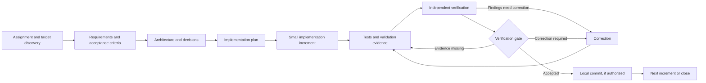

# Autonomous Engineering Harness

A reusable foundation for working through software assignments in an existing or new target repository. It defines an evidence-based engineering lifecycle, review contracts, quality gates, and reusable project-document templates. It is designed to be language- and architecture-neutral.

The current release is a **documented workflow foundation**. It does not yet include an executable orchestrator, CLI, automatic policy enforcement, or multi-agent runtime. A single Codex session can follow the workflow manually using the prompts and contracts here.

## Repository boundary

Use this repository for reusable instructions and process assets. Use a separate target repository for the actual product, its requirements, code, tests, migrations, deployment files, and project-specific evidence. At the beginning of an engagement, identify the target path and read its instructions. Do not copy product files into this repository.

## Lifecycle

## Start here

1. Read [the working instructions](AGENTS.md) and [the goals and roadmap](harness/GOALS.md).
2. Read [the workflow](docs/workflow.md), [the architecture](docs/architecture.md), [the verification framework](docs/verification-framework.md), and the [operation and verification policy](harness/config/verification-policy.yaml).
3. Receive an explicit target path; verify canonical roots, Git common/ref/object stores, and authorized path scopes are independent from the harness; then establish applicable instructions, capabilities, current status, documentation structure, and existing work before proposing changes.
4. Use the reusable prompts under `harness/prompts/` and copy/adapt templates into the target repository only when needed.
5. Record project-specific requirements, decisions, traceability, reviews, and build evidence in the target repository.

## Contents

- `harness/workflows/`: lifecycle and operating procedure.
- `harness/prompts/`: reusable prompts for discovery through verification and single-agent execution.
- `harness/verification/`: reviewer contracts and evidence rules.
- `harness/gates/`: stage-gate policy.
- `harness/schemas/`: JSON Schema contracts for workflow state, traceability, evidence, findings, and gate decisions.
- `harness/config/`: default verification policy.
- `harness/templates/`: starting points for target-repository documents.
- `docs/`: architecture, workflow, decisions, and generalized lessons.

## Current limitations

The documents, matrix, state, and schemas describe intended process controls; they do not technically enforce them. There are no executable scripts, dependency requirements, permission broker, state store, identity provider, or CI integration in this initial foundation. The single-agent workflow is a human/agent instruction set, not an autonomous service. Reviewer roles, authentication evidence, and gate authority are contracts only; no coordinator, agent runtime, Draft 2020-12 schema validator, cross-record evidence/revision validator, identity verifier, or policy evaluator is implemented. Report attestations cannot prove substantive reviewer exhaustiveness.

## Roadmap

See [PLANS.md](PLANS.md) for planned increments and completion boundaries. Suggestions and implementation ideas should remain distinct from approved commitments.
