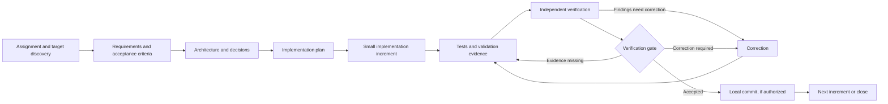

# Autonomous Engineering Harness

Repository: `autonomous-engineering-harness`

A reusable foundation for working through software assignments in an existing or new target repository. It defines an evidence-based engineering lifecycle, review contracts, quality gates, reusable project-document templates, and a read-only target preflight CLI. It is designed to be language- and architecture-neutral.

The current release is a **documented workflow foundation with a read-only preflight CLI**. It does not include an executable engineering orchestrator, write broker, automatic gate evaluator, or multi-agent runtime. A single Codex session can follow the workflow manually using the prompts and contracts here.

## Repository boundary

Use this repository for reusable instructions and process assets. Use a separate target repository for the actual product, its requirements, code, tests, migrations, deployment files, and project-specific evidence. At the beginning of an engagement, identify the target path and read its instructions. Do not copy product files into this repository.

## Lifecycle



## Start here

1. Read [the working instructions](AGENTS.md) and [the goals and roadmap](harness/GOALS.md).
2. Read [the workflow](docs/workflow.md), [the architecture](docs/architecture.md), [the verification framework](docs/verification-framework.md), and the [operation and verification policy](harness/config/verification-policy.yaml).
3. Receive an explicit target path; verify canonical roots, Git common/ref/object stores, and authorized path scopes are independent from the harness; then establish applicable instructions, capabilities, current status, documentation structure, and existing work before proposing changes.
4. Use the reusable prompts under `harness/prompts/` and copy/adapt templates into the target repository only when needed.
5. Record project-specific requirements, decisions, traceability, reviews, and build evidence in the target repository.

## Contents

- `harness/workflows/`: lifecycle and operating procedure.
- `harness/prompts/`: reusable prompts for discovery through verification and single-agent execution.
- `harness/verification/`: reviewer contracts and evidence rules.
- `harness/gates/`: stage-gate policy.
- `harness/schemas/`: JSON Schema contracts for workflow state, traceability, evidence, findings, and gate decisions.
- `harness/preflight.py`: dependency-free read-only target identity, isolation, state, instruction, scope, and filesystem inspection.
- `harness/schemas/preflight-config.schema.json`: optional JSON input contract for preflight scopes and instruction roots.
- `harness/config/`: default verification policy.
- `harness/templates/`: starting points for target-repository documents.
- `docs/`: architecture, workflow, decisions, and generalized lessons.

## Read-only target preflight

Run from any working directory with an explicit repository-root target:

```sh
./harness/preflight.py --target /absolute/path/to/target
```

Optional scope and instruction-root configuration is JSON. An omitted or empty `included_paths` list authorizes zero writes. `--workspace-root` explicitly authorizes inspection of the direct ancestor instruction chain; without it, preflight does not read above the target root.

```sh
./harness/preflight.py \
  --target /absolute/path/to/target \
  --workspace-root /absolute/path/to/workspace \
  --config /absolute/path/to/preflight.json
```

The config may contain `target_path`, `workspace_root`, `instruction_roots`, `authorized_working_directories`, `included_paths`, `code_paths`, `artifact_paths`, `revision_paths`, and `excluded_paths`. The CLI requires Python 3.10+ and uses only the standard library plus the Git executable. It prints a structured JSON report; exit codes are `0` for `READY`, `2` for `BLOCKED`, and `3` for `NEEDS_HUMAN_INPUT`. Individual check records classify invalid input separately from unsafe conditions and human-input requirements.

Example scope config:

```json
{
  "included_paths": ["src", "docs"],
  "code_paths": ["src"],
  "artifact_paths": ["docs"],
  "revision_paths": ["src", "docs"],
  "excluded_paths": []
}
```

Preflight verifies Git identity and separation from the harness, reads repository state, inventories instructions/capabilities and documentation locations, validates configured scopes, and observes symlinks, hard links, and filesystem identity. It never writes to the target, executes discovered instructions, installs tools, or contacts external services. A `READY` report means these read-only checks passed for the observed state. It does not enforce safety for future writes: a future writer must revalidate paths and inode/link identity at the operation boundary and must provide race-safe containment. Ancestor instruction reads occur only for roots explicitly supplied through `--workspace-root` or `instruction_roots`.

The standard-library test suite runs with `python3 -m unittest discover -s tests -v`.

## Current limitations

The documents, matrix, workflow state, and schemas describe intended process controls; most are not technically enforced. The preflight CLI enforces its read-only inspection contract and validates observed identity and scope inputs, but there is no write permission broker, state store, identity provider, CI integration, engineering orchestrator, agent runtime, Draft 2020-12 schema validator, cross-record evidence/revision validator, identity verifier, or policy evaluator. Reviewer roles, authentication evidence, and gate authority remain contracts. Report attestations cannot prove substantive reviewer exhaustiveness.

## Roadmap

See [PLANS.md](PLANS.md) for planned increments and completion boundaries. Suggestions and implementation ideas should remain distinct from approved commitments.
