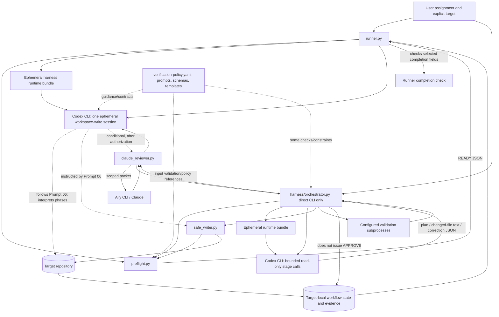

# Architecture and Execution Guide

> Historical diagnostic snapshot of the pre-consolidation checkout. Its inventory, repository status, and many implementation findings below are intentionally preserved as investigation evidence and are not current operating instructions. Since this snapshot was written, `harness/orchestrator.py` became the sole supported workflow entrypoint and a workspace-scoped execution policy replaced per-increment write allowlists for orchestrated tasks. `harness/runner.py` is deprecated. Use [README.md](../README.md), [docs/orchestrator.md](orchestrator.md), and [docs/workflow.md](workflow.md) for current behavior.

## Scope and evidence basis

This guide describes the repository as inspected in its current working tree. It distinguishes behavior visible in Python code from workflow rules stated in Markdown/YAML. No target product repository was inspected, no Codex or Claude implementation task was launched, and the test suite was read but not run.

The working tree already contained user changes before this guide was created: `harness/orchestrator.py`, `docs/orchestrator.md`, `harness/schemas/orchestrator-plan.schema.json`, and `harness/schemas/orchestrator-stage-result.schema.json` were untracked; `harness/schemas/workflow-state.schema.json` was modified. A later no-ignore inventory also surfaced `tests/test_orchestrator.py` as untracked. The orchestrator and its test are therefore analyzed as files present in this checkout, but are not represented as committed or integrated into the documented `runner.py` entrypoint. The guide does not treat these worktree files as part of a clean release baseline.

## Repository map

The harness is a language-neutral workflow and tooling repository. It has no product application, dependency manifest, migrations, or deployment program. The Python CLIs use the standard library and the Git executable; runtime integrations require Codex CLI and, for external reviews, Aily/Claude.

Directory roles: `harness/` contains executable tools and reusable process assets; `harness/config/` contains policy configuration; `prompts/`, `workflows/`, `verification/`, and `gates/` contain instructions/contracts; `schemas/` contains JSON contracts; `templates/` contains document starters; `docs/` contains repository documentation; `tests/` contains test code. In the inventory, `.py` files are executable code, YAML is policy/configuration, Markdown files are instructions/policies/documentation/templates, JSON files are schemas/contracts, and `tests/*.py` are tests. The `.git` internals, local `.DS_Store` files, and Python `__pycache__` artifacts are not workflow components.

| Path | Responsibility and contents | Use and dependencies |
|---|---|---|
| `.gitignore` | Excludes editor/OS files, local environments/secrets, caches, and build outputs. | Repository hygiene only; Git applies it. |
| `AGENTS.md` | Governing repository instructions: target separation, write scope, safe-writer requirements, lifecycle, authorization, review, and evidence rules. | Applied as instructions by the primary session; it is not itself a runtime enforcement mechanism. |
| `LICENSE` | Repository license text. | Legal/documentation file; no runtime dependency. |
| `PLANS.md` | Roadmap and status, including the runner, reviewer adapter, and incomplete autonomous orchestration work. | Planning record. Some statements describe the documented runner path and predate the untracked orchestrator. |
| `README.md` | User-facing entrypoints, lifecycle, preflight and safe-writer usage, boundaries, and limitations. | Main operational overview. Documents `runner.py` as the normal task launcher. |
| `docs/architecture.md` | Earlier architecture and boundary overview focused on the single-session runner, preflight, and safe writer. | Useful for core design, but its statement that no orchestrator exists is narrower/older than this working tree, which contains an untracked `orchestrator.py`. |
| `docs/orchestrator.md` | Usage and limitations of the explicit stage controller. | Untracked in the inspected tree; describes a direct CLI path separate from `runner.py`. |
| `docs/workflow.md` | Human/agent operating guide for discovery through closeout and use of the runner. | Operational documentation consumed by Codex; no executable state machine. |
| `docs/decisions.md` | Accepted repository-level process decisions, including primary-agent role and safety boundaries. | Normative design record, interpreted by agents. |
| `docs/lessons-learned.md` | Generalized findings from prior workflow attempts. | Reference material; not executable. |
| `docs/verification-framework.md` | Evidence, review, identity, risk, and gate concepts. | Normative/reviewer guidance; policy evaluation is not implemented by this document. |
| `harness/GOALS.md` | Mission, goals, non-goals, and success signals. | Planning and scope reference. |
| `harness/runner.py` | CLI launcher for a single ephemeral Codex session; performs preflight first and verifies a target-local completion claim afterward. | Primary documented shell entrypoint. Uses `preflight.py`, copies an ephemeral tool bundle, and launches Codex. Does not import or call `orchestrator.py`. |
| `harness/orchestrator.py` | Separate stage controller for planning, implementation, validation, Claude review, correction, and final handoff. | Directly executable if called, but untracked here, absent from the README's standard entrypoint, not called by `runner.py`, and covered only by a focused untracked unit-test module. |
| `harness/preflight.py` | Read-only target identity, Git isolation, repository state, scope, instruction, capability, symlink, and hard-link inspection. | Called by the runner and safe writer; imported directly by the orchestrator. |
| `harness/safe_writer.py` | Scope-checked directory creation and file creation/replacement with filesystem identity checks and JSON evidence. | The orchestrator calls its Python functions. Prompt 06 directs the primary Codex session to use its CLI for target writes; the runner does not enforce that instruction. |
| `harness/claude_reviewer.py` | Request and persisted authorization validation, one-shot review-round claims, scoped snapshots, Aily invocation, response validation, and review evidence creation. | Imported/called by the orchestrator and intended for authorized Claude review from the Prompt 06 workflow. |
| `harness/config/verification-policy.yaml` | Detailed policy for target identity, Git environment, path scopes, authorization, risk bands, evidence, findings, and gates. | The runner embeds it in the Codex prompt and preflight duplicates relevant Git policy in code. The policy itself says its gate semantics are documented rather than implemented as a complete evaluator. |
| `harness/prompts/00-discovery.md` | Discovery checklist and source inventory. | Referenced by Prompt 06; interpreted by Codex. |
| `harness/prompts/01-requirements.md` | Requirements, classifications, and acceptance-criteria instructions. | Referenced by Prompt 06; interpreted by Codex. |
| `harness/prompts/02-architecture-and-plan.md` | Architecture decisions and incremental plan instructions. | Referenced by Prompt 06; interpreted by Codex. |
| `harness/prompts/03-implement-increment.md` | Implementation-phase constraints. | Used for each increment by Prompt 06; interpreted by Codex. |
| `harness/prompts/04-independent-verification.md` | Verification and reviewer assignment/checklist instructions. | Used by Prompt 06, but self-review remains self-review and cannot satisfy independence. |
| `harness/prompts/05-correction-and-gate.md` | Finding correction, evidence refresh, and gate reconciliation instructions. | Used by Prompt 06; does not execute a gate evaluator. |
| `harness/prompts/06-autonomous-single-agent.md` | Complete top-level single-agent lifecycle, authorization limits, safe-writer rules, review limits, resume behavior, and closeout requirements. | Primary operating prompt embedded by `runner.py`; the Codex session interprets and carries out its phases. |
| `harness/workflows/engineering-lifecycle.md` | Phase ordering and lifecycle contract. | Documentation used by the workflow owner; not a state engine. |
| `harness/verification/reviewer-contracts.md` | Requirements, QA, code, architecture, and security reviewer responsibilities and reporting expectations. | Used as reviewer guidance; Claude receives the applicable contract text through a request. |
| `harness/gates/verification-gate.md` | Gate checklist, outcomes, evidence and authority requirements. | Policy/instructions. No standalone evaluator executes it in the runner path. |
| `harness/templates/requirements.md` | Target-local requirements and acceptance criteria document template. | Copied/adapted by a workflow owner; no automatic instantiation in `runner.py`. |
| `harness/templates/implementation-plan.md` | Increment plan template with scope, validations, risk and evidence fields. | Documentation template. |
| `harness/templates/architecture.md` | Target architecture record template. | Documentation template. |
| `harness/templates/decisions.md` | Target decision log template. | Documentation template. |
| `harness/templates/acceptance-traceability.md` | Criterion-to-evidence traceability table template. | Documentation template. |
| `harness/templates/build-log.md` | Validation/build record template. | Documentation template. |
| `harness/templates/review-report.md` | Detailed independent review report template. | Documentation template; Claude itself returns a much smaller JSON report. |
| `harness/schemas/workflow-state.schema.json` | Target workflow state shape, including target identity, scope, baseline, phase, authorizations, Claude cycles, completion and (in the current modified tree) optional orchestration fields. | Structural contract. It does not validate cross-record freshness or policy semantics by itself. |
| `harness/schemas/preflight-config.schema.json` | Optional preflight configuration shape for target path, instruction roots, working directories, and scopes. | Contract for preflight input; semantic checks are in `preflight.py`. |
| `harness/schemas/evidence.schema.json` | Evidence record fields, including command, result, artifact, criterion, revision, and review metadata. | Structural contract for target-local records. |
| `harness/schemas/finding.schema.json` | Canonical finding severity, classification, impact, evidence, disposition, and risk-acceptance fields. | Structural contract; disposition policy is in YAML/docs. |
| `harness/schemas/traceability.schema.json` | Acceptance criterion to requirement, decision, implementation, documentation, test, and evidence linkage. | Structural contract. |
| `harness/schemas/verification-decision.schema.json` | Verification gate result, revision, authority, evidence, findings, and reviewer references. | Structural contract; the runner only checks a subset of completion fields. |
| `harness/schemas/claude-review-report.schema.json` | Claude's compact response: `decision`, `summary`, and `findings`. | Enforced by request/report validation in `claude_reviewer.py`, with additional semantic checks. |
| `harness/schemas/reviewer-finding-decision.schema.json` | Codex's structured disposition of reviewer findings. | Contract referenced by the review workflow; separate from Claude's report. |
| `harness/schemas/orchestrator-plan.schema.json` | Planning response with requirements, criteria, risk, context, capabilities, and increments. | Untracked with the orchestrator; code also validates the shape manually. |
| `harness/schemas/orchestrator-stage-result.schema.json` | Implementation/correction response with status, summary, changed file text, and optional finding decisions. | Untracked with the orchestrator; code also validates the shape manually. |
| `tests/test_preflight.py` | Isolated Git-repository tests for identity, shared stores, environment, repository state, scopes, instructions, and filesystem observations. | Unit/integration-style local tests with fixture repositories; no real external service. |
| `tests/test_safe_writer.py` | Tests creation, replacement, scope, link/path races, errors, baseline hashes, and preservation of pre-existing changes. | Exercises helper functions/CLI behavior with temporary repositories; does not prove races by arbitrary writers are impossible. |
| `tests/test_runner.py` | Tests prompt construction, stable IDs, runtime bundle hash checks, Codex arguments, preflight failures, and final-state checks. | Uses mocked subprocess results; does not run a real Codex task. |
| `tests/test_claude_reviewer.py` | Tests request/report validation, authorization, budgets, review cycles, stale snapshots, read-only invocation arguments, evidence, and recovery scenarios. | Aily process calls are mocked. Two end-to-end scenarios exercise adapter/workflow-cycle logic with synthetic outputs, not the stage orchestrator or a live provider. |
| `tests/test_orchestrator.py` | Tests commit-config rejection, scoped plan validation, stage-response validation, workflow directory/evidence writing, revision-bound validation evidence, increment ordering, and blocked/waiting resume behavior. | Uses temporary directories, mocked process calls and patched preflight. It does not run a complete target task, real Codex/Aily, or a gate approval. The file is untracked in this working tree. |

## Architecture

There are two separate executable workflow paths in the inspected tree. The first is the documented runner path. The second is the untracked explicit stage controller. Shared contracts and tools do not make the two paths one connected program.



Solid arrows represent calls or data movement supported by code. Dotted arrows are instruction or contract relationships. In the runner path, Python performs preflight, copies/hashes a temporary tool bundle, launches Codex, and validates final state fields. Codex interprets the lifecycle, chooses and runs target work under its CLI sandbox, records workflow artifacts, and is instructed to use the safe writer. In the orchestrator path, Python controls the stage order and validation calls; Codex is given bounded read-only tasks and returns structured content. The orchestration controller applies returned file content through the safe writer. `runner.py` does not call `orchestrator.py`.

### Main entrypoints

| Entrypoint | Invocation | Actual job |
|---|---|---|
| Preflight | `python3 harness/preflight.py --target /absolute/repo` | Read-only inspection; optional `--config`, `--workspace-root`, and `--harness-root`. Exit 0 `READY`, 2 `BLOCKED`, 3 `NEEDS_HUMAN_INPUT`. |
| Single-session runner | `python3 harness/runner.py --target /absolute/repo (--task TEXT | --task-file FILE)` | Preflight, one Codex CLI session, then completion-state check. Optional `--workflow-id`, `--codex`, and `--claude-budget-usd`. |
| Stage orchestrator | `python3 harness/orchestrator.py --target /absolute/repo --branch BRANCH (--task TEXT | --task-file FILE) --config FILE` | Separate plan/implement/validate/review/correct loop. Optional `--workflow-id`, `--codex`, and `--aily`. This entrypoint is not invoked by the runner. |
| Safe writer | `python3 harness/safe_writer.py {mkdir,create,replace} --target ... --config ... --path ...` | Performs fresh preflight then one scoped filesystem operation; file bytes for create/replace come from stdin. Replacement also requires `--expected-sha256`. |
| Claude adapter | `python3 harness/claude_reviewer.py --target ...` with JSON request on stdin | Validates and performs a single authorized review attempt, returning compact JSON to stdout. The normal documented flow may call its functions from a workflow owner instead of invoking this CLI directly. |
| Tests | `python3 -m unittest discover -s tests -v` | Runs the standard-library test suite. Not run for this analysis. |

## Execution and workflow components

### `harness/runner.py`

`main()` accepts an explicit absolute target and task text or task file. `_workflow_id()` creates a stable ID from the canonical target and task text unless `--workflow-id` is supplied, so a repeat can resume the same assignment. `run_task()` resolves the target, calls `run_preflight()`, creates a temporary tool runtime with `_runtime_bundle_files()`, builds `operating_prompt()`, and calls `invoke_codex()`.

The Codex invocation is `codex exec --json --ephemeral --sandbox workspace-write --cd <target> [--add-dir <runtime>] -`, with the operating prompt on stdin. The sandbox is the target root plus the runtime directory; there is no per-increment path sandbox. The runtime bundle copies the operating docs, policy, prompts, schemas, reviewer contracts, gate/lifecycle docs, and tools, then hashes them and uses `_runtime_bundle_unchanged()` to detect changes during the run.

After a zero Codex exit code, `completion_status()` finds a unique target-local `workflow-state.json` for the workflow and checks matching workflow/target identity, `status=COMPLETED`, `phase=COMPLETED`, `completion.gate_outcome=APPROVE`, a `content:<sha256>` revision, and non-empty evidence IDs. It does not independently validate the JSON Schema, evidence records, findings register, reviewer assignments, revision manifest, gate authority, or the full policy cross-record invariants. Thus it is a fail-closed completion-claim check, not a gate evaluator.

The runner redacts selected credential-like patterns from returned diagnostics. Its optional Claude budget is passed as `HARNESS_CLAUDE_TOTAL_BUDGET_USD`; with no budget, the runner itself sets no monetary ceiling. It does not commit, push, create a PR, or directly call Claude.

### `harness/orchestrator.py` (present but untracked)

The controller has `Orchestrator`, `WorkflowStore`, `validate_config()`, `_plan_valid()`, `_stage_valid()`, `_run_command()`, and stage methods `_planning()`, `_increment()`, `_validate()`, `_review_and_gate()`, `_review_increment()`, and `_correct_and_reverify()`.

`initialize()` requires a canonical Git root and exact existing branch, runs `Preflight`, captures current state, and initializes `.engineering/workflows/<workflow_id>/workflow-state.json` plus a task record. It checks the workflow ID, target, branch, task hash, and pre-existing changed-path hashes when resuming. Workflow artifacts are written through `WorkflowStore`, which calls safe-writer functions with narrow generated scope configs.

Codex is invoked one stage at a time in a temporary runtime bundle with `codex exec --json --ephemeral --sandbox read-only --cd <target> --add-dir <runtime> --output-schema <schema> --output-last-message <file> -`. The plan stage returns requirements, acceptance criteria, risk, context, capabilities and increments. Implementation/correction returns full UTF-8 file contents in `changes`; `_apply_changes()` validates paths and applies them via safe writer. Codex does not directly edit target files on this path.

The orchestrator runs only validation IDs selected in the plan from the user-supplied JSON config. It records command, cwd, status, output excerpt, timing, revision, evidence IDs and artifact paths. `_run_command()` executes argv directly (no shell) with a timeout and a filtered environment; it has a command-name/subcommand/argument denylist, and enforces `--no-restore` for dotnet test/build. This is a guardrail, not an OS sandbox or a complete proof that every allowed executable is offline or non-destructive. Validation commands are not automatically discovered by Python.

For review, the controller requires a positive `claude_budget_usd` when review is enabled, gathers current passing validation evidence, reserves a deterministic target/increment review cycle, and calls `claude_reviewer.run_claude_review()`. It sends findings to a bounded Codex correction call, requires a decision for each finding, reruns current validations, and uses the adapter's one follow-up review round. Deferred findings pause for human input. Maximum configured correction iterations are 1–5.

There are material completion limits in the code. `_review_and_gate()` moves High-risk work to `WAITING_FOR_HUMAN`; for Low/Medium it sets `BLOCKED` because cross-record policy evaluation is not implemented. No code path assigns a fresh workflow `COMPLETED`/`APPROVE` result. `commit=true` is explicitly rejected by `validate_config()` and `create_pr=true` is rejected; there is no commit or PR implementation. The controller also does not create the canonical finding register and full verification decision records required by the gate policy.

The authorization construction in `_review_increment()` is a significant accuracy limit: it synthesizes a declared user authorization and hard-codes `authority_reference` to “Explicit Claude/Aily authorization in the BPHA-4727 task instructions,” while this controller does not inspect the task text to establish that the current task actually granted that external call. The adapter validates the fields, timing, exact scope and persisted workflow binding, but declared provenance is not authentication or proof that the stated prompt source contained those terms. Do not infer generic task authorization from this controller's generated record.

### Workflow state and artifacts

There is no database or shared service. State is target-local JSON, conventionally `.engineering/workflows/<workflow_id>/workflow-state.json`; requirements, decisions, plan, evidence, review reports, findings, revision manifests, and gate records are stored in the same workflow directory or target's established equivalent. Prompt 06 says Codex owns this state in the runner flow. The orchestrator creates a simpler workflow record and appends its `orchestration` object.

The state schema records target/harness Git identities, authorized scope, baseline commit and pre-existing status, phase/status, phase records, artifact references, reviewer assignments, authorizations, pending decisions, Claude cycles, and completion data. The modified schema in this tree also allows orchestration fields for branch, stage, increment status, attempts, validation/review results, and revision references. JSON Schema describes shape; code/policy still needs to check relationships, freshness, target identity and allowed transitions.

Typical records look like this (illustrative field subset, not a complete schema instance):

```json
{
  "workflow_id": "<stable-id>",
  "target": {"target_id": "<id>", "git_root": "<absolute-target-root>"},
  "scope": {
    "increment_id": "I-001",
    "included_paths": ["src", "docs", ".engineering/workflows/<stable-id>"],
    "code_paths": ["src"],
    "artifact_paths": ["docs", ".engineering/workflows/<stable-id>"],
    "revision_paths": ["src", "docs"],
    "excluded_paths": [".git"]
  },
  "baseline": {"commit": "<original-commit>", "preexisting_changes": []},
  "phase": "TESTING",
  "status": "ACTIVE",
  "artifact_references": [".engineering/workflows/<stable-id>/plan.json"],
  "pending_decisions": [],
  "updated_at": "<ISO-8601>"
}
```

Requirements and plans link IDs to source references; the orchestrator's `orchestrator-plan.schema.json` uses requirement/criterion records `{id,text,source}` and increments with `code_paths`, `artifact_paths`, `revision_paths`, `acceptance_criteria_ids`, and `validation_ids`. Traceability records link criteria to requirements, decisions, implementation/docs/tests, status, and evidence IDs.

Evidence records bind target and increment to kind, observed time/result, optional exact command, working directory and exit code, artifact/source references, criterion IDs, limitations, and revision metadata. Policy requires `content:<sha256>` revision identity over original baseline commit, exact sorted `revision_paths`, and sorted file manifest; commit SHA is provenance, not content identity. Findings have canonical ID, reviewed revision, source reviews, severity, classification, location/scenario, evidence, impact, recommendation, and disposition/risk-acceptance data. The verification decision records exact revision, scope, risk, authority, evidence, findings source/fingerprint, reviewers, blocking and accepted-risk finding IDs, and open decisions.

Claude's request is a Python-validated JSON object, not a dedicated request schema. It includes target/workflow/increment/revision, baseline, assigned paths, task/requirements/criteria, reviewer contract, context paths, verification evidence artifacts and hashes, persisted authorization, review cycle, and optional budget. Its response schema is compact:

```json
{"decision":"APPROVED","summary":"<review summary>","findings":[]}
```

Each finding contains `id`, `severity`, `file`, `description`, and `recommendation`. `APPROVED` requires an empty findings list. The adapter also validates scope and revision, Aily's JSON envelope, and evidence. Invocation metadata may record model, session/invocation IDs, token usage, and cost. Cost is cumulative only when an explicit limit is supplied; if previous spend is unknown, the adapter blocks another budgeted call. Raw process output is not stored as the review record; hashes and redacted diagnostics are retained.

## Repository safety and authorization boundaries

### Preflight: `harness/preflight.py`

`Preflight.run()` calls configuration loading, root identification, Git environment preparation, Git identity/isolation checks, repository-state inspection, scope validation, instruction/capability discovery, and filesystem inventory. The target path is explicit and must be the canonical Git root. The target and harness roots must be disjoint. The code strips inherited `GIT_*` variables after checking their names, establishes controlled Git environment settings, rejects external Git config includes and executable content filters, resolves Git common/refs/object paths and transitive alternates, and compares metadata/object path and inode identities.

It reads Git status/worktree/submodule state, validates scope path normalization and classification, rejects Git metadata/nested repository scopes and symlinked scope paths, and inventories instructions/capabilities/docs without executing them. Filesystem inventories exclude Git/dependency/generated directories, have size caps, and report links/hard links. These are observations; preflight does not constrain later writes or prove properties omitted by the inventory limits. Since harness and target identity must be independent, this preflight contract is not a mechanism for treating this harness checkout as its own product target.

### Writes: `harness/safe_writer.py`

`create_file()`, `create_directories()`, and `replace_file()` first validate the explicit config/scope and rerun fresh preflight, requiring `READY`. `included_paths` must equal the union of `code_paths` and `artifact_paths`; exactly one classification must cover a destination and exclusions win. The helper uses no-follow, directory-relative operations and binds work to verified root/parent directory handles.

`mkdir` creates missing components exclusively, authorizing each missing component separately; a later failure preserves and reports earlier created directories. `create` refuses any existing destination and uses exclusive creation. `replace` requires a lowercase SHA-256 expected baseline, a regular single-link file, stable path/descriptor identity and content through the final check, and uses a temporary file plus fsync and atomic rename. It checks post-write content and retains mode/owner/group where possible. JSON operation evidence contains path, hashes, filesystem identities and link count.

The documented concurrency assumption is one writer. Atomic rename is not compare-and-swap: a non-cooperating write after the final check may still race. The helper does not preserve ACLs or extended attributes, and reports partial nested directory creation instead of rolling it back. These are real limits, not properties that preflight removes.

### Branch, commit, push, and PR behavior

Preflight inspects repository status and the orchestrator requires a named current branch; neither creates a branch. The workspace policy permits local Git inspection and exact-path staging. Commit, checkout, branch creation, reset, clean, merge, push, and PR operations remain separately authorized or unavailable. The stage orchestrator rejects automatic commits and PR creation and implements neither operation. There is no Git hosting integration.

### Written rules versus enforcement

| Boundary | Enforced in code | Instruction/policy-only part or limit |
|---|---|---|
| Explicit target and Git separation | Preflight validates canonical Git roots and disjoint Git metadata/object stores. | Workflow still depends on Codex using the correct target and recording artifacts. |
| Per-path write allowlist | Safe writer enforces its supplied config for each operation; orchestrator applies returned file changes through it. | Runner's Codex sandbox permits workspace writes across the target root. Prompt 06's instruction to use safe writer is not technically forced by runner. |
| Single writer | Not an OS lock. | Humans/automation are instructed to pause; arbitrary non-cooperating races remain possible. |
| Review read-only scope | Adapter builds a temporary snapshot from explicitly authorized files and diff/evidence, uses `--restricted`, `--tools Read,Glob,Grep`, and disables MCP config. | This is a file-tool restriction, not OS process isolation. Aily receives the authorized review packet externally. |
| Claude authorization | Adapter validates persisted operation, target, workflow, increment, reviewer, paths, data types, expiry/revocation, budget, evidence and a workflow-owner scope fingerprint. | Declared identity/source are attestations; not authenticated proof. Current orchestrator fabricates the source reference noted above. |
| Validation command limits | Orchestrator accepts argv arrays, enforces timeouts and a denylist, strips selected environment variables, and blocks some network/install/destructive forms. | It is not a complete executable sandbox; arbitrary allowed executables can have broader effects. The runner path leaves validation selection/execution to Codex and target tooling. |
| Evidence freshness / gate correctness | Adapter validates its own review inputs; runner checks a small completion field set. | Full cross-record gate semantics, policy-derived reviewer roster, all evidence freshness and findings reconciliation are not implemented by the runner. The orchestrator stops before approval. |
| Human identity and approval | Schemas hold identity and authentication references. | No identity provider/authentication verifier is implemented. High-risk human approvals remain external. |
| Commit/PR/deploy/external operations | Orchestrator rejects commit/PR config; adapter handles its specific external review call. | Other operations depend on explicit task-specific authorization and human/agent interpretation; no publish/deploy integration exists. |

## Complete task walkthrough

### Path A: documented `runner.py` flow

1. The caller supplies `--target` and exactly one of `--task` or `--task-file`. `main()` reads UTF-8 task text. The target must be absolute, resolve to a directory, and represent the exact Git root expected by preflight.
2. `run_task()` makes or validates a workflow ID and calls `run_preflight()`. A nonzero preflight or a report other than `READY` prevents Codex launch.
3. Python creates a temporary bundle of harness tools/contracts and records file hashes. `operating_prompt()` supplies target, workflow ID, task, Prompt 06, `AGENTS.md`, and the verification policy.
4. `invoke_codex()` starts one ephemeral Codex CLI session with `workspace-write` access to the target root and the runtime bundle. It does not call a Python phase controller. Thereafter, Codex interprets discovery, requirements, architecture, plan, increments, validations, self-review, correction, and gate instructions.
5. Codex is instructed to inspect target instructions and existing state, capture baseline/status, derive scopes and requirements, and persist workflow state before writes. These actions are not independently performed or phase-validated by `runner.py`.
6. Codex modifies files under the target. Prompt 06 requires explicit scopes and `safe_writer.py` for directory/file writes. The launcher does not mediate each path write or prevent direct edits within its workspace-write sandbox.
7. Codex selects applicable target validation commands, runs them, records exact evidence, applies reviewer contracts for self-review, and corrects findings. The runner does not select validation commands, interpret results, or rerun failures itself.
8. For policy-required Medium-risk external review, Prompt 06 requires task-specific persisted authorization and evidence. Codex may call `claude_reviewer.py`; the adapter validates the request, builds and hashes a scoped snapshot, claims a reserved attempt in workflow state, invokes Aily/Claude, validates the response, and returns review metadata. The reviewer does not edit or run target commands.
9. Codex triages Claude findings, corrects accepted issues in scope, reruns impacted checks, and may reserve the permitted follow-up review. Human-required reviews/approvals remain outside the agent. The phase transition and finding/evidence consistency work are agent-driven.
10. The gate policy requires a full cross-record evaluation and allowed authority. No evaluator is called by the runner. Codex must record a legitimate gate result under the existing policy; missing authority leaves the workflow incomplete.
11. On Codex success, Python verifies the ephemeral runtime hashes and then calls `completion_status()`. Only a target-local `COMPLETED` record with `APPROVE`, matching target/workflow, valid immutable revision syntax and nonempty final evidence IDs is accepted. This check verifies claims/shape, not the policy decision itself. No commit, push or PR is performed by the runner.

### Path B: direct `orchestrator.py` flow

1. The caller supplies absolute target, existing branch, task, and config JSON. The config preselects validations, timeouts, risk floor, correction limit, reviewer context and Claude budget.
2. `initialize()` verifies Git root and branch, runs `Preflight`, captures pre-existing status and hashes, and creates target-local workflow state and `task.json` through `WorkflowStore`/safe writer.
3. `_planning()` invokes Codex with a read-only sandbox and `orchestrator-plan.schema.json`. Python validates the returned requirements/criteria/increments and stores `plan.json`; a `NEEDS_HUMAN_INPUT` plan persists a pending decision.
4. `_increment()` sends one bounded implementation request with the current increment and criteria. Codex returns file paths and full text. Python validates allowed paths and uses safe writer to create/replace files; it checks for out-of-scope changes and altered pre-existing work.
5. `_revision_manifest()` hashes the planned revision paths and derives a `content:<sha256>` identity from the original baseline, sorted paths and manifest. `_validate()` runs only configured validations referenced by the increment, records results/evidence, and rejects a validation that changes the revision.
6. `_review_increment()` reserves a deterministic Claude cycle, assembles task/context/evidence, constructs an authorization record, then calls the adapter. The adapter validates exact paths, authorization/evidence, claims the attempt, calls Aily in a temporary read-only snapshot, validates the JSON report and returns metadata. Current orchestrator code's synthesized authorization source must be treated as a limitation, not as verified task authorization.
7. If findings are returned, `_correct_and_reverify()` calls Codex in a read-only sandbox, requires one decision per finding, applies returned changes via safe writer, refreshes the revision manifest, reruns validations, records decisions, and initiates the second review round. Deferred findings wait for the task owner.
8. `_review_and_gate()` does not approve. High risk waits for authenticated human reviewer and distinct gate approver. Low/Medium is marked blocked pending an evaluator result because none is implemented. The direct CLI therefore does not provide full autonomous completion or commit/PR behavior.

## Validation and reliability

The current `tests/` directory contains five test modules; `tests/test_orchestrator.py` is untracked in this working tree:

| Module | Main covered behavior | Important gaps |
|---|---|---|
| `tests/test_preflight.py` | Invalid/missing targets, harness overlap, linked worktrees, shared Git hard-links/object alternates, unsafe Git environment/config, dirty/untracked/submodule status, traversal/symlink/nested-repo scopes, instruction discovery, and filesystem observations. | Does not prove every platform/filesystem edge case or arbitrary external race; does not run a product task. |
| `tests/test_safe_writer.py` | Create/replace/mkdir semantics; scope and empty allowlist; symlinks, hard links, stale content and identities; failure cleanup/evidence; preservation of unrelated changes; fresh preflight requirement. | Tests simulate controlled race windows, not a non-cooperating writer after the final check; no ACL/xattr preservation. |
| `tests/test_runner.py` | Stable resume IDs, prompt and budget forwarding, snapshot hashes, Codex CLI flags, preflight blocking, JSONL diagnostics, state lookup, duplicate/symlink workflow states, and completion acceptance. | Uses a fake Codex subprocess. Does not prove Prompt 06 compliance, target gate semantics, per-path sandboxing, or live Codex behavior. |
| `tests/test_claude_reviewer.py` | Aily invocation arguments, response-envelope parsing, authorization, cost limits, report validation, review-cycle limits/recovery, path/evidence checks, stale revision/snapshot behavior, and two simulated review-correction scenarios. | Mocks external process results; does not verify live Aily credentials, provider behavior, true OS confinement, or the controller's overall gate. |
| `tests/test_orchestrator.py` | Tests commit-config rejection, scoped plan validation, stage-response validation, workflow directory/evidence writing, revision-bound validation evidence, increment ordering, and blocked/waiting resume behavior. | Uses temporary directories, mocked process calls and patched preflight. It does not run a complete target task, real Codex/Aily, or a gate approval. The file is untracked in this working tree. |

The untracked orchestrator has focused unit coverage but no dedicated automated integration or full end-to-end coverage. The two Claude “e2e” tests are local synthetic scenarios around adapter/workflow-cycle code, not full runner-to-Codex-to-Aily workflows. No suite currently proves that documented Prompt 06 procedure produces a policy-compliant final state in a real target repository. This assessment is from test source inspection only; no command was run here.

## Current autonomy assessment

The classifications below distinguish the documented runner workflow from what executable code itself automates. “Partially automated” does not mean that policy correctness or successful live service behavior has been proven.

| Intended stage | Current classification | Evidence and limits |
|---|---|---|
| 1. Receive one task | Partially automated | Runner/orchestrator CLIs accept task text and explicit root. Task interpretation and ambiguity handling are performed by Codex. |
| 2. Analyze and plan | Dependent on Codex interpreting instructions (runner); partially automated (orchestrator) | Runner only prompts. Orchestrator invokes a bounded planning call and validates/stores a structured plan. |
| 3. Invoke Codex to implement | Partially automated | Runner launches one session; orchestrator launches stage calls and applies returned text. Scope enforcement differs: per-file safe-writer enforcement exists in orchestrator, while runner's sandbox covers the target root. |
| 4. Run validations | Dependent on Codex interpreting instructions (runner); partially automated (orchestrator) | Runner has no validation executor. Orchestrator runs configured commands/timeouts and stores evidence, but user supplies commands and its denylist is not a complete sandbox. |
| 5. Invoke Claude independently | Partially automated, authorization-dependent | Adapter has real invocation code, scoped snapshots, and read-only Claude file-tool settings. Invocation requires external authorization and service availability. Orchestrator currently constructs rather than verifies the task's authorization source. |
| 6. Process findings | Dependent on Codex interpreting instructions (runner); partially automated (orchestrator) | Runner prompt defines triage/correction. Orchestrator calls Codex to decide and apply findings but does not complete canonical gate reconciliation. |
| 7. Correct and revalidate | Dependent on Codex interpreting instructions (runner); partially automated (orchestrator) | Prompt 06 directs correction/revalidation. Orchestrator implements one correction/follow-up path, bounded by iteration and review cycles. |
| 8. Repeat when necessary | Partially automated | Prompt 06 specifies loops. Adapter/orchestrator support at most two completed Claude rounds, with explicit audited recovery rules for failed attempts. This is bounded, not an unlimited self-healing loop. |
| 9. Create commits | Manual/separately authorized in runner workflow; not implemented in orchestrator | Runner has no commit API but Codex could perform an explicitly authorized commit under the prompt. Orchestrator rejects `commit=true`. |
| 10. Create a PR | Not implemented | No PR integration. Orchestrator rejects `create_pr=true`; runner does not create one. |
| 11. Deliver a complete report | Partially automated | Runner returns a concise success object only after its completion check. Prompt 06 requires a richer report, but Codex authors it. Orchestrator returns status/workflow/stage/phase/state path and currently ends blocked/waiting rather than completed. |

## Final architecture summary

### Task sequence

```mermaid
sequenceDiagram
  actor User
  participant Runner as runner.py
  participant Preflight as preflight.py
  participant Codex as Codex CLI
  participant Writer as safe_writer.py
  participant Target as Target repo/state
  participant Adapter as claude_reviewer.py
  participant Aily as Aily / Claude

  User->>Runner: explicit target + task
  Runner->>Preflight: read-only target identity/scope checks
  Preflight-->>Runner: READY or block
  Runner->>Runner: create/hash temporary harness bundle
  Runner->>Codex: one ephemeral workspace-write session + Prompt 06
  Codex->>Target: inspect, plan, record state, implement and validate per instructions
  Codex->>Writer: scoped filesystem operation (instructed)
  Writer->>Preflight: fresh preflight for write
  Writer->>Target: create/replace authorized paths
  opt policy-required and explicitly authorized external review
    Codex->>Adapter: scoped request + persisted authorization/evidence
    Adapter->>Target: verify state, revision and evidence; claim round
    Adapter->>Aily: authorized packet in restricted temporary snapshot
    Aily-->>Adapter: JSON envelope and compact report
    Adapter-->>Codex: validated report, metadata, evidence mapping
    Codex->>Target: triage/correct/revalidate and update workflow records
  end
  Codex-->>Runner: exit status and JSONL output
  Runner->>Target: inspect completion claim
  Runner-->>User: completion result or blocker
```

This sequence is for the documented runner path. The explicit orchestrator has a different sequence: Python controller → bounded read-only Codex plan/implementation/correction calls → safe-writer changes → configured validation subprocesses → Claude adapter; it then leaves the gate incomplete because no evaluator produces an approval.

### Responsibilities to files

| Responsibility | Primary files |
|---|---|
| Task launch and completion check | `harness/runner.py`, `harness/prompts/06-autonomous-single-agent.md` |
| Explicit stage orchestration (worktree-only addition) | `harness/orchestrator.py`, `harness/schemas/orchestrator-plan.schema.json`, `harness/schemas/orchestrator-stage-result.schema.json`, `docs/orchestrator.md` |
| Target/Git/filesystem preflight | `harness/preflight.py`, `harness/schemas/preflight-config.schema.json` |
| Scoped file operations | `harness/safe_writer.py` |
| Claude/Aily review and evidence | `harness/claude_reviewer.py`, `harness/schemas/claude-review-report.schema.json`, `harness/schemas/evidence.schema.json` |
| Workflow policy and approvals | `harness/config/verification-policy.yaml`, `harness/gates/verification-gate.md`, `docs/verification-framework.md` |
| Lifecycle and phase instruction | `docs/workflow.md`, `harness/workflows/engineering-lifecycle.md`, `harness/prompts/00`–`06` |
| State, findings, traceability and decisions | `harness/schemas/workflow-state.schema.json`, `finding.schema.json`, `traceability.schema.json`, `verification-decision.schema.json`, and target-local records |
| Reusable target artifacts | `harness/templates/*.md` |
| Existing automated coverage | `tests/test_preflight.py`, `test_safe_writer.py`, `test_runner.py`, `test_claude_reviewer.py`, and untracked `tests/test_orchestrator.py` |

### Most important limitations

- The documented runner launches one Codex session and delegates lifecycle transitions to it; it is not a stage engine or complete gate evaluator.
- The runner's workspace-write sandbox is target-root-wide. It does not technically require every write to pass through safe writer.
- Policy, prompt, schema, and template artifacts are not equivalent to executable enforcement. Cross-record gate correctness and identity authentication are not implemented.
- The new stage orchestrator and its focused unit-test module are untracked and unintegrated with `runner.py`; it intentionally cannot produce `APPROVE` or `COMPLETED` today.
- The orchestrator's Claude authorization source is hard-coded and synthesized, so its existence alone does not establish the current task's user authorization.
- The orchestrator executes user-configured validation programs with a command-shape denylist, not a comprehensive process sandbox.
- No PR, push, deployment, CI integration, policy evaluator, or identity provider is present.
- External review transmits the authorized review packet to Aily; cost ceilings are enforceable only when supplied, and provider execution/authentication is not verified by the unit tests.

### Smallest missing capabilities for the stated autonomous workflow

For the documented runner path, the smallest gaps are a durable stage/evidence controller, technically scoped write mediation for every product write, a complete policy evaluator that reconciles state/evidence/reviews/findings against the exact final content identity, and available independent/human approval authority where policy requires it. Commit/PR creation also needs a separately authorized integration; neither can be inferred from a task or from a passing gate. The current direct orchestrator covers some stage sequencing and validation execution, but deliberately stops before gate approval and publication.
