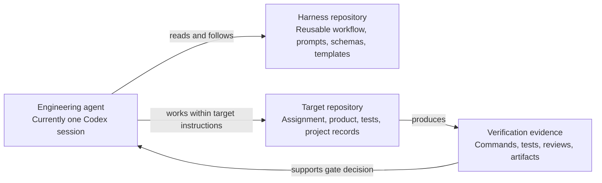

# Harness Architecture

## Purpose

The harness is a reusable process and contract repository. Product code is owned by a separate target repository. The workflow remains document-first and dependency-free; its first executable component is a read-only target preflight CLI.

## Repository boundary

The harness does not contain a target product or receive copied target source. An invocation supplies an explicit target path; the preflight uses a sanitized Git environment and verifies canonical working roots, Git common/ref directories, object stores/alternates, and shared refs/object inodes are disjoint from the harness. It reads repository status, worktrees, and submodule state, inventories authorized instruction roots and project capabilities, validates configured code/artifact scopes, and reports filesystem observations. Writes are restricted by policy to explicit target code and artifact allowlists; an empty allowlist means no writes. Preflight does not implement a writer or enforce future write containment. Hard links are observed separately from symlinks; a future writer must recheck file and directory identity at each operation and fail closed when race-safe replacement is unavailable. Product records and evidence remain in the target, following its existing documentation structure. `docs/workflow.md` defines target resolution, immutable revision identity, instruction discovery, authorization, skills, workflow state, and continuous documentation.

## Current components

- **Instruction layer:** repository-wide working boundaries and source-of-truth rules.
- **Workflow layer:** lifecycle from discovery to closeout.
- **Prompt layer:** reusable task instructions for one agent.
- **Verification layer:** reviewer contracts and evidence/status definitions.
- **Gate layer:** decision outcomes and minimum approval checks.
- **Contract layer:** JSON Schemas for workflow state, evidence, traceability, findings, and gate decisions.
- **Template layer:** project-specific documents to adapt in the target repository.
- **Read-only preflight:** `harness/preflight.py`, a Python 3.10+ standard-library CLI with a JSON report and optional JSON scope configuration. It does not execute discovered instructions or write target artifacts.

The Verification Gate binds to an immutable content fingerprint over explicit `revision_paths`; a later commit SHA is provenance and must be shown to represent the same content. Reviewer completion reports and assigned scopes are reconciled, but no schema can prove a reviewer disclosed every substantive observation. Identity/session strings are declared data. Human approvals that policy requires need verifiable external authentication evidence; no identity provider is selected or implemented.

The lifecycle, state, evidence, identity, and gate contracts are not yet enforced by an orchestrator. The preflight CLI enforces its own no-target-write behavior and validates the observed target identity, Git separation, scope shape, and filesystem observations. It cannot provide race-safe future writes, identity verification, state persistence, evidence validation, or gate decisions. The path authorization and gate rules outside this read-only component remain contracts, not technical enforcement.

## Future-compatible role boundaries

The workflow distinguishes Implementer, Workflow Coordinator, Policy Evaluator, and independent Requirements, QA/Test, Code, Architecture, and Security Reviewer responsibilities. A policy evaluator may approve only low-risk increments that satisfy all automatic conditions; medium-risk work requires an independent review; high-risk work requires a human reviewer and authorized human gate approver. Reviewers are read-only. A handoff carries target ID/revision, scope, requirements, evidence references, applicable instructions/skills, and decision authority. These roles can later map to separate processes or agents, but no runtime, agent framework, or coordination protocol is implemented here.
