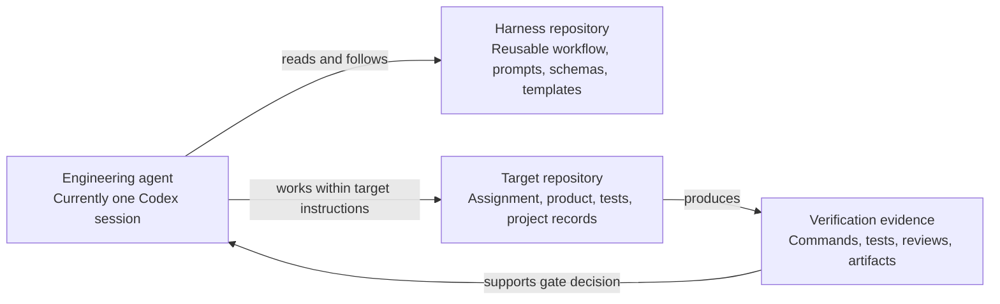

# Harness Architecture

## Purpose

The harness is a reusable process and contract repository. Product code is owned by a separate target repository. The initial architecture is deliberately document-first and dependency-free.

## Repository boundary

The harness does not contain a target product or receive copied target source. A future runner may read this repository while executing in the target repository, but the target path, instructions, allowed commands, and evidence destination must be explicit.

## Current components

- **Instruction layer:** repository-wide working boundaries and source-of-truth rules.
- **Workflow layer:** lifecycle from discovery to closeout.
- **Prompt layer:** reusable task instructions for one agent.
- **Verification layer:** reviewer contracts and evidence/status definitions.
- **Gate layer:** decision outcomes and minimum approval checks.
- **Contract layer:** JSON Schemas for evidence, traceability, findings, and gate decisions.
- **Template layer:** project-specific documents to adapt in the target repository.

These are text contracts. There is no command runner, state store, permission broker, CI gate, or automatic validator yet.

## Future-compatible role boundaries

The single-agent workflow uses explicit responsibilities. Future independent workers could map to Coordinator, Developer, QA, Code Reviewer, Architecture Reviewer, and Security Reviewer. Handoffs should carry target/revision, scope, requirements, artifact references, and decision authority. Reviewers remain read-only. No runtime, agent framework, or coordination protocol is implemented here.
