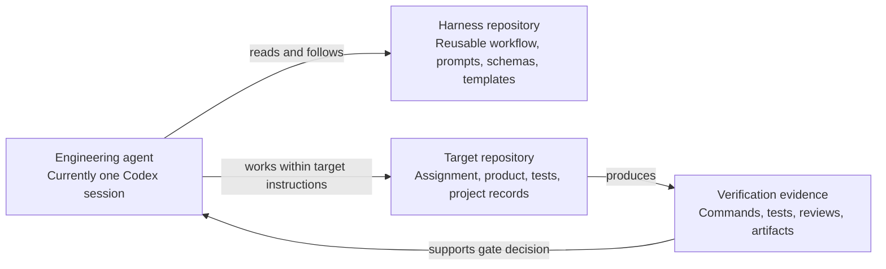

# Harness Architecture

## Purpose

The harness is a reusable process and contract repository. Product code is owned by a separate target repository. The initial architecture is deliberately document-first and dependency-free.

## Repository boundary

The harness does not contain a target product or receive copied target source. An invocation supplies an explicit target path; discovery uses a sanitized Git environment and verifies canonical working roots, Git common/ref directories, object stores/alternates, and hard-linked refs/objects are disjoint from the harness. Writes are restricted to explicit target code and artifact allowlists; an empty allowlist means no writes. Hard links are checked separately from symlinks, and unsupported safe replacement fails closed. Product records and evidence remain in the target, following its existing documentation structure. `docs/workflow.md` defines target resolution, immutable revision identity, instruction discovery, authorization, skills, workflow state, and continuous documentation.

## Current components

- **Instruction layer:** repository-wide working boundaries and source-of-truth rules.
- **Workflow layer:** lifecycle from discovery to closeout.
- **Prompt layer:** reusable task instructions for one agent.
- **Verification layer:** reviewer contracts and evidence/status definitions.
- **Gate layer:** decision outcomes and minimum approval checks.
- **Contract layer:** JSON Schemas for workflow state, evidence, traceability, findings, and gate decisions.
- **Template layer:** project-specific documents to adapt in the target repository.

The Verification Gate binds to an immutable content fingerprint over explicit `revision_paths`; a later commit SHA is provenance and must be shown to represent the same content. Reviewer completion reports and assigned scopes are reconciled, but no schema can prove a reviewer disclosed every substantive observation. Identity/session strings are declared data. Human approvals that policy requires need verifiable external authentication evidence; no identity provider is selected or implemented.

These are text contracts. There is no command runner, state store, permission broker, CI gate, identity provider, or automatic validator yet. The path, authorization, identity, and gate rules are intended contracts, not technically enforced controls.

## Future-compatible role boundaries

The workflow distinguishes Implementer, Workflow Coordinator, Policy Evaluator, and independent Requirements, QA/Test, Code, Architecture, and Security Reviewer responsibilities. A policy evaluator may approve only low-risk increments that satisfy all automatic conditions; medium-risk work requires an independent review; high-risk work requires a human reviewer and authorized human gate approver. Reviewers are read-only. A handoff carries target ID/revision, scope, requirements, evidence references, applicable instructions/skills, and decision authority. These roles can later map to separate processes or agents, but no runtime, agent framework, or coordination protocol is implemented here.
