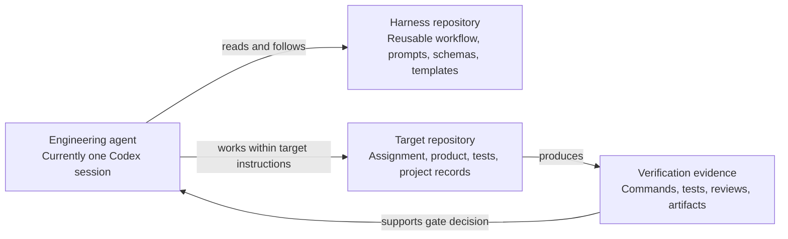

# Harness Architecture

## Purpose

The harness is a reusable process and contract repository. Product code is owned by a separate target repository. Its supported workflow execution entrypoint is the dependency-free Python stage orchestrator; read-only preflight remains a standalone diagnostic CLI.

## Repository boundary

The harness does not contain a target product or receive copied target source. An invocation supplies an explicit target path; preflight uses a sanitized Git environment and verifies canonical working roots, Git common/ref directories, object stores/alternates, and shared refs/object inodes are disjoint from the harness. At workflow initialization, the orchestrator persists one versioned workspace policy bound to the canonical target and workflow ID. Routine assignment-related project edits, development commands, approved dependency installation, workflow evidence, and bounded internal review/correction need no path-by-path or per-operation approval. Local Git inspection and exact-path staging are permitted; commits and history/remote operations remain gated. `revision_paths` describe review identity, not write permission. Safe Writer validates workspace binding, re-runs preflight, performs no-follow directory-relative file operations, rejects hard-linked files, verifies content/identity, and records evidence. Workflow-created files may be renamed or deleted. Pre-existing user changes and unrelated files are protected. The writer relies on the single-writer assumption; atomic rename is not a compare-and-swap and does not protect against arbitrary non-cooperating writers.

## Current components

- **Instruction layer:** repository-wide working boundaries and source-of-truth rules.
- **Workflow layer:** lifecycle from discovery to closeout.
- **Prompt layer:** reusable task instructions for one agent.
- **Verification layer:** reviewer contracts and evidence/status definitions.
- **Gate layer:** decision outcomes and minimum approval checks.
- **Contract layer:** JSON Schemas for workflow state, evidence, traceability, findings, and gate decisions.
- **Template layer:** project-specific documents to adapt in the target repository.
- **Read-only preflight:** `harness/preflight.py`, a Python 3.10+ standard-library CLI with a JSON report and optional JSON scope configuration. It does not execute discovered instructions or write target artifacts.
- **Stage orchestrator:** `harness/orchestrator.py`, the sole supported workflow execution entrypoint for planning, scoped implementation, configured validation, review coordination, correction, and target-local state.
- **Legacy launcher:** `harness/runner.py`, deprecated and retained temporarily for compatibility; it is not a supported workflow path.

The Verification Gate binds to an immutable content fingerprint over explicit `revision_paths`; a later commit SHA is provenance and must be shown to represent the same content. Reviewer completion reports and assigned scopes are reconciled, but no schema can prove a reviewer disclosed every substantive observation. Identity/session strings are declared data. Human approvals that policy requires need verifiable external authentication evidence; no identity provider is selected or implemented.

The stage orchestrator controls the phases it implements and persists target-local state, but it does not enforce every lifecycle, evidence, identity, or gate contract. In particular, it does not authenticate humans or implement the complete cross-record gate evaluator. The preflight CLI remains read-only. Safe Writer enforces its own target, workspace, path, directory, and file checks; it does not force unrelated processes to use the helper or make gate decisions. The command filter is a guardrail rather than OS-level process confinement. The single-writer assumption is operational and does not provide protection against a non-cooperating race after the last check.

## Future-compatible role boundaries

The workflow distinguishes Implementer, Workflow Coordinator, Policy Evaluator, and independent Requirements, QA/Test, Code, Architecture, and Security Reviewer responsibilities. A policy evaluator may approve only low-risk increments that satisfy all automatic conditions; medium-risk work requires an independent review; high-risk work requires a human reviewer and authorized human gate approver. Reviewers are read-only. A handoff carries target ID/revision, scope, requirements, evidence references, applicable instructions/skills, and decision authority. These roles can later map to separate processes or agents, but no runtime, agent framework, or coordination protocol is implemented here.
