# Phase 0 — Architectural characterization

**Status:** Complete (read-only)  
**V1:** `/Users/slcosentino/Documents/Preparacion/autonomous-engineering-harness`, branch `main`, HEAD `9c3eb06721beaefce3b5d093130feae9683a117a`  
**V2:** `/Users/slcosentino/Documents/Preparacion/autonomous-engineering-harness-modular`, branch `architecture/modular-v2`, HEAD `9c3eb06721beaefce3b5d093130feae9683a117a`  
**Shared base:** `9c3eb06721beaefce3b5d093130feae9683a117a`  
**Scope:** Source, tests, repository instructions, and existing documentation inspected. No application source, tests, or V1 files were changed. Tests were not executed in this characterization phase.

## Executive findings

`harness/orchestrator.py` contains 4,797 lines and defines the `Orchestrator` class at line 765. It is both the lifecycle owner and the implementation home for several capabilities. The greatest concentration is in `_run_pending_stages`, `_run_codex_impl`, `_call_claude_impl`, and the review-campaign helpers.

The repository already has cohesive modules for workspace inspection, baseline-aware review input, review report/campaign logic, traceability, Codex evidence parsing, process control, locks, authorization, persistence, delivery rendering, and observability. The migration should reuse these boundaries. The clearest existing boundary violation is `ReviewCampaign`: it accepts the mutable workflow-state dictionary and save/provider/authorization callbacks, then mutates campaign and coverage fields itself.

The recommended first implementation scope is deliberately small: split the stage loop into explicit coordinator methods and extract deterministic planning, plan-review, implementation, and correction request construction. Keep provider invocation, operation tracking, state format, and recovery unchanged in that phase. The highest-coupling extraction is `ReviewCampaign`, but it is also the highest-risk one and should follow dedicated checkpoint/recovery characterization.

## Current responsibilities

| Concern | Current implementation | Characterization |
|---|---|---|
| Lifecycle and transitions | `Orchestrator._start_locked`, `_approve_locked`, `_revise_locked`, `_reject_locked`, `_resume_locked`, `_run_pending_stages`, `_fail` | Coordinator-like responsibility, but mixed with capability implementation in the same class. Explicit approval gates implementation. |
| Workflow and target locking | `_execute_locked`, `_workflow_lock`, `_target_process_lock`; `workflow/process_locks.py` | Cross-process locking exists and must remain around mutating operations. |
| Persisted state and artifacts | `_save`, `_read_state`, `_load`, `_write_proposal`, `_delivery_report`; `workflow/persistence.py` | State and artifacts are target-local under `.engineering/workflows/<workflow_id>/`. Writes are atomic; state writes require the workflow lock. |
| Authorization, budget, operation history | `_new_operation`, `_operation_launching`, `_operation_process_started`, `_finish_operation`, `_resource_usage`, `_execution_limits`; `workflow/authorization.py` | Shared workflow policy and audit state currently live primarily in `Orchestrator`; authorization module validates persisted scopes and budget history. |
| Planning and prompt construction | Planning branch in `_run_pending_stages`, `_plan_review_prompt`, `_repository_context_for_claude`, `_refined_proposal`; `workflow/planning_review.py` only normalizes scorecards | Prompt/input shaping is not independently testable. Stage decisions and proposal persistence must remain in the coordinator. |
| Codex execution | `_run_codex`, `_run_codex_impl`, `_run_process_with_pid`, `_codex_cli_version`, `build_codex_command`; `workflow/codex_evidence.py`, `workflow/process_control.py` | Provider command/process behavior is interleaved with operation records, authorization, persistence, timeouts, output recovery, and evidence. |
| Claude/Aily execution | `_call_claude`, `_call_claude_impl`; `claude_reviewer.py` | `claude_reviewer.py` owns subprocess transport and response/cost decoding. `Orchestrator` owns workflow authorization, context construction, operation history, budget accounting, and recovery. Payload validation responsibility overlaps and should be characterized before consolidation. |
| Review input and campaign | `_review_diff`, `_record_review_snapshot`, `_code_review_shared_context`, `_prepare_review_campaign`, `_run_review_campaign`; `workflow/review_input.py`, `workflow/review.py` | Baseline/diff construction is already separate. Campaign partitioning and report validation are in `review.py`, but campaign persistence/provider calls reach through callbacks and shared mutable state. |
| Commitment ledger/evidence | `_capture_commitment_evidence`, `_capture_commitment_assessment`, `_evaluate_commitment_delivery`, `_commitment_review_context`; `workflow/traceability.py`, `workflow/codex_evidence.py` | Parsing and evaluation are partly modular. Orchestrator binds provider output to operation history, approved ledger, review provenance, and persisted gates. |
| Delivery and integrity | `_verify_delivery_integrity`, `_verify_delivery_artifact_hash`, `_delivery_report`; `workflow/delivery.py` | Rendering is separate. Final integrity and completion decisions are stateful workflow gates and belong to the coordinator; pure calculations can move with explicit inputs. |
| Workspace and guidance | `_capture_initial_fingerprints`, `_require_current_approval_baseline`, `_guidance`; `workflow/workspace.py`, `workflow/skills.py` | Workspace owns Git inventory, fingerprints, snapshots, instruction discovery, and skill selection. Coordinator decides how those outputs affect transitions. |
| Optional observability | `_begin_execution_trace`, `_trace_span`, `_finish_execution_trace`; `observability/` | Trace enablement is authorized and tracing failures are isolated from workflow results. Keep optional. |

## Lifecycle and stage flow

```mermaid
stateDiagram-v2
    [*] --> planning: start; save baseline and authorization
    planning --> plan_review_1: proposal persisted
    plan_review_1 --> plan_refine_1: review report persisted
    plan_refine_1 --> plan_review_2: another review remains
    plan_refine_1 --> awaiting_approval: planning complete
    plan_review_2 --> plan_refine_2: second report persisted
    plan_refine_2 --> awaiting_approval: planning complete
    awaiting_approval --> implementation: explicit approve only
    awaiting_approval --> rejected: explicit reject
    implementation --> code_review: summary and evidence persisted
    code_review --> correction: blocking findings and correction is authorized
    code_review --> complete: no blocking findings; gates satisfied
    correction --> verification: correction and evidence persisted
    verification --> complete: independent verification passes
    verification --> failed: verification blocks delivery
    planning --> failed: stage error
    implementation --> recovery_required: uncertain launched operation
    code_review --> recovery_required: uncertain provider operation
    recovery_required --> running: explicit valid recovery resolution
    failed --> running: resume saved failed stage
```

The exact stage branches are in `Orchestrator._run_pending_stages` (line 4057 onward). `start` captures the baseline and authorization, saves state, then calls `run_pending`. `approve` only accepts `awaiting_approval`, rechecks baseline and proposal/ledger binding, saves the implementation stage, and then runs it. `resume` reloads the saved stage and does not implicitly approve.

Status values include `running`, `awaiting_approval`, `failed`, `recovery_required`, `complete`, and `rejected`. Persisted stage values include planning/review/refinement stages, human revision, implementation, code review, correction, verification, and complete. New stages therefore affect state compatibility and resume behavior.

## State ownership and operation ordering

Today, `Orchestrator.state` is the authoritative mutable dictionary. It includes workflow ID/target/task, baseline commit and snapshots, authorization, proposal and review versions, operation history, resource usage, recovery, evidence, campaign state, commitment gate, delivery disposition, and status/stage.

The target-local artifacts are:

- `.engineering/workflows/<workflow_id>/state.json`
- `.engineering/workflows/<workflow_id>/proposal.md`
- `.engineering/workflows/<workflow_id>/delivery.md` for completed delivery

A provider operation is recorded before launch. Codex starts through a process-group-aware path and persists a child PID after launch; output, usage, result text, hashes, and status are later recorded. A launched operation with no terminal result enters recovery rather than being assumed not to have run. Claude/Aily spend with no recorded cost sets `budget_unknown` and blocks further paid calls. A retry path exists only after explicit recovery inputs, including verified Claude cost and provider inactivity.

## ReviewCampaign coupling and recovery

`workflow/review.py::ReviewCampaign` is already a class with substantial review responsibility, but its constructor accepts `state: dict` plus callbacks for save, Claude invocation, call-count authorization, and tracing. The class mutates `review_campaign`, `review_files_not_reviewed`, review exclusions, partition failures, and call count. Its `_run_review_campaign` checkpoints each part and can recover a completed report from saved Claude context by campaign/part/prompt hash. A refactor must preserve these checkpoint and reuse rules while moving authoritative persistence to the Coordinator.

`review_input.build_review_diff` in `workflow/review_input.py` accounts for baseline and preexisting changes, added/deleted/untracked files, sensitive paths, binary/metadata exclusions, review scope, and patch hashes. `ReviewDiff` currently lives in `workflow/review.py`, which `review_input.py` imports only for that data type; this is an avoidable dependency inversion.

## Existing module ownership

- `workflow/workspace.py`: Git operations, target validation, fingerprints, snapshots, path protection, instructions, project skills.
- `workflow/review_input.py`: safe baseline-aware review diff and file exclusions.
- `workflow/review.py`: review partitioning, coverage, report validation, campaign recovery; presently also mutable state/callback orchestration.
- `workflow/planning_review.py`: scorecard normalization only.
- `workflow/codex_evidence.py`: Codex JSONL/stream, tool, model, usage, and test-event extraction.
- `workflow/traceability.py`: Commitment Ledger parsing, evidence/assessment parsing, JUnit provenance checks, and commitment dispositions.
- `workflow/delivery.py`: delivery report rendering.
- `workflow/authorization.py`: workflow authorization and budget validation/change history.
- `workflow/persistence.py`: safe atomic files and JSON serialization.
- `workflow/process_locks.py`, `workflow/process_control.py`: lock lifecycle and process-group cancellation.
- `claude_reviewer.py`: Claude/Aily payload checks, subprocess invocation, response and cost decoding.
- `workflow/cli.py`: CLI parsing/status formatting; it currently imports review internals for feedback rendering.
- `workflow/github.py`, `observability/`, and `tools/read_documentation_url.py`: existing integrations; not Phase 1 extraction targets.

## Test coverage inspected and gaps

The test suite has focused files for authorization, budget/resume, Codex evidence, delivery, GitHub, observability, plan-review scorecards, process control, review input, traceability, skills, workflow concurrency, and the main workflow. `tests/test_workflow.py` contains extensive lifecycle and provider-failure coverage.

Representative existing guarantees include:

- Approval: `test_plan_is_saved_and_implementation_waits_for_explicit_approval`, `test_proposal_approval_binds_the_user_visible_ledger_snapshot`.
- Process and recovery: `test_timeout_records_partial_output_and_interruptions_leave_started_operation_for_recovery`, `test_completed_codex_result_is_reused_after_parent_stops_before_stage_advance`, `test_interrupted_claude_call_marks_cost_unknown_and_is_not_repeated`.
- Review: `test_large_review_uses_adaptive_parts_shared_context_and_integration`, `test_resume_reuses_successful_parts_and_retries_only_failed_part`, `test_unknown_part_spend_blocks_all_later_campaign_calls`.
- Baseline/provenance: `test_review_campaign_sees_preexisting_staged_context_without_attributing_it_to_codex`, `test_baseline_snapshot_includes_staged_unstaged_and_untracked_context_but_attributes_only_new_deltas`.
- Evidence/delivery: `test_junit_artifact_must_match_its_operation_and_target_snapshot`, `test_missing_independent_assessment_cannot_produce_complete_delivery`, `test_code_change_between_final_review_and_delivery_blocks_completion`.
- Concurrency/cancellation: tests in `test_workflow_concurrency.py` and `test_process_control.py`.

Gaps to address in later phases, not Phase 0:

1. No architecture test currently enforces import direction, coordinator-only state mutation, or absence of coordinator parameters in capabilities.
2. Prompt construction is embedded in stage logic; there are no independent deterministic builder tests.
3. The existing campaign test `test_campaign_runs_through_state_and_provider_callbacks_without_orchestrator` proves it can run without an Orchestrator instance, but it still uses the shared state dictionary and callbacks; it is not proof of a narrow contract.
4. Crash coverage is broad, but the Phase 3 refactor should add a table-driven three-part campaign checkpoint test covering crash points before launch, after launch, after report persistence, and after campaign checkpoint persistence.
5. The test suite was inspected but not run in Phase 0; no pass/fail claim is made.

## Extraction candidates and risk

| Priority | Candidate | Benefit | Risk |
|---|---|---|---|
| 1 | Split `_run_pending_stages` into named stage methods and extract deterministic prompt/request builders | Makes lifecycle policy visible and prompt logic independently testable without touching process/recovery semantics. | Low if prompts, saves, calls, and transitions remain byte/behavior compatible. |
| 2 | Extract Codex invocation mechanics from `_run_codex_impl` | Moves command/process implementation out of the lifecycle owner. | Medium/high: operation state, save order, PID persistence, timeouts, captured output, and recovery are interleaved. |
| 3 | Refactor `ReviewCampaign` to snapshot/request/result functions | Removes direct capability access to authoritative mutable state. | Highest: paid multi-part calls, persisted contexts, partial reports, unknown costs, recovery, and campaign state must remain aligned. |
| 4 | Make evidence/delivery calculations explicit-input functions | Improves independent tests and clarifies provenance. | Medium: inputs are currently derived from several state sections and target files. |
| 5 | Move remaining class into `workflow/coordinator.py` | Clarifies final package ownership after extraction. | Low only after earlier boundaries are proven; high if done before. |

## Recommended Phase 1 scope

1. Extract stage branches from `_run_pending_stages` into explicit methods on the existing class; do not move the class yet.
2. Add pure request/prompt builders for proposal planning and plan review. Reuse `planning_review.py` for plan-review shaping and scorecard normalization rather than duplicating that responsibility.
3. Add pure implementation and correction request builders in a focused `workflow/execution.py` module.
4. Keep `_run_codex`, `_call_claude`, provider flags, operation creation, state writes, evidence extraction, and recovery unchanged.
5. Add deterministic tests for builders and regression tests asserting the existing transition/save sequence, especially approval gating and review count.

Phase 1 acceptance: existing persisted JSON shape and CLI behavior are unchanged; deterministic builders accept explicit inputs rather than state/Orchestrator; planning still stops at `awaiting_approval`; implementation only starts after explicit approval; targeted lifecycle tests pass. No later phase begins until this is explicitly approved.
