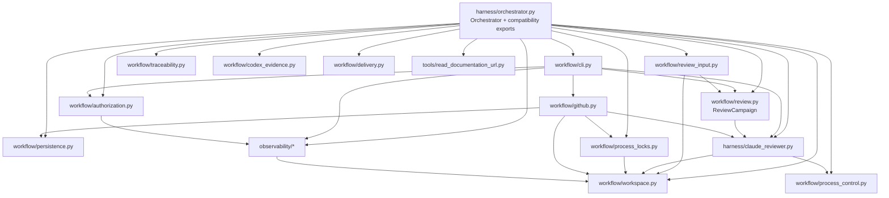
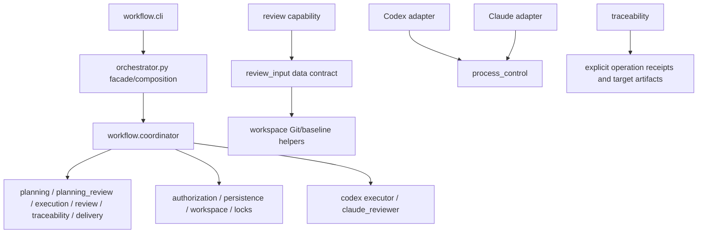

# Phase 0 — Dependency and ownership map

**Base:** `9c3eb06721beaefce3b5d093130feae9683a117a`  
**Method:** Python import statements and current call sites inspected locally; no runtime dependency checker or test suite was run. This is the current V1/V2-base graph, not the proposed V2 graph.

## Current dependency diagram

The diagram shows direct imports, not every runtime call. `orchestrator.py` is the high fan-out module and re-exports some workspace/review APIs for tests and compatibility. No static import cycle was found among the `workflow` modules in the inspected import statements. There are still dependency-direction problems and state coupling that an acyclic graph alone would not detect.

## Existing modules and permitted future ownership

| Module | Current responsibility | Current direct dependencies | Future direction |
|---|---|---|---|
| `orchestrator.py` | CLI composition, `Orchestrator`, stage loop, lifecycle, provider calls, operations, shared state, review integration, evidence and delivery gates, compatibility wrappers. | `workflow.*`, `claude_reviewer`, `observability.*`, `tools.*`. | Reduce to entry/facade after extraction; lifecycle owner moves later to `workflow/coordinator.py`. |
| `workflow/cli.py` | Argument parsing and result/status rendering. | Authorization, review helpers, Aily adapter, observability, GitHub integration. | Depend on application/coordinator API; remove direct imports of review implementation functions. |
| `workflow/review.py` | Review data, report parsers, partitioning, coverage, recovery, `ReviewCampaign`. | `claude_reviewer.py`; campaign also depends on injected callbacks and mutable workflow state at runtime. | Own review algorithms and snapshots/results; no provider invocation, persistence callback, or workflow state. |
| `workflow/review_input.py` | Git/baseline-aware review packet and exclusions. | `workspace.py` plus `ReviewDiff` imported from `review.py`. | Own `ReviewDiff` (or a narrowly justified shared review-input type); review consumes it. This reverses the current dependency to producer → consumer direction. |
| `workflow/planning_review.py` | Scorecard normalization. | Standard library. | Keep; can own plan-review input/normalization without overlapping proposal generation. |
| `workflow/codex_evidence.py` | Codex JSONL/stream, tool, test, token/model event extraction. | Standard library. | Keep low-level result parsing; receive provider output explicitly. |
| `workflow/traceability.py` | Ledger/evidence schema parsing, operation/event/JUnit provenance, commitment disposition. | Standard library and target `Path` passed to JUnit readers. | Keep explicit-input validation; do not import lifecycle modules. |
| `workflow/delivery.py` | Delivery report rendering from supplied state-like mapping and metadata. | Standard library. | Keep rendering; any integrity calculation must use explicit values and return checks, not change lifecycle. |
| `workflow/workspace.py` | Git, target path policy, fingerprints, snapshots, guidance, provider environment. | Standard library. | Infrastructure base; must not import Coordinator or CLI. |
| `workflow/authorization.py` | Persisted authorization and budget validation/change history. | `observability.tracer` for observability-scope validation. | Remain policy/infrastructure; must not import application lifecycle. |
| `workflow/persistence.py` | Safe atomic text/JSON IO. | Standard library. | Remain low-level IO; no workflow decisions. |
| `workflow/process_locks.py` | Cross-process lock operations. | `workspace.py` for workflow root/lock name. | Remain infrastructure; no lifecycle imports. |
| `workflow/process_control.py` | Process-group creation and termination. | Standard library. | Remain infrastructure; called by provider adapters. |
| `claude_reviewer.py` | Aily/Claude CLI validation, invocation, timeout, output/cost decoding. | Workspace and process control. | Keep as Claude adapter; Coordinator controls workflow budget and operation persistence. |
| `workflow/github.py` | GitHub issue import, reporting/publication and registry. | Claude redaction, persistence, locks, workspace. | Separate integration; avoid broadening Phase 1. Review direct redactor dependency separately. |
| `observability/*` | Trace interfaces, no-op behavior, Langfuse integration. | Langfuse adapter uses workspace provider environment. Authorization imports scope helpers. | Optional cross-cutting integration; tracing failures must not control workflow outcome. |
| `tools/read_documentation_url.py` | Read-only URL documentation tool. | Standard library. | Existing isolated tool; not a Phase 1 target. |

## Coupling that matters for modular V2

1. **Coordinator-to-capability fan-out:** `orchestrator.py` imports many private helpers and implementation types. Some imports exist only to preserve compatibility. Moving the class without shrinking these dependencies would be a relocation, not modularization.
2. **Review campaign owns mutable state:** `ReviewCampaign` reads/writes many top-level workflow fields and receives save, provider, authorization, and trace callbacks. It is not a pure capability boundary despite being in `workflow/review.py`.
3. **Review-input dependency inversion:** `review_input.py` imports `ReviewDiff` from `review.py`; the input producer depends on the downstream campaign implementation for its data type.
4. **CLI-to-review implementation edge:** `workflow/cli.py` imports `_validated_campaign_reports` and `render_review_feedback` to display status. The CLI should consume a status result prepared by the application boundary.
5. **Provider boundary split:** `claude_reviewer.py` owns the Aily subprocess, while `_call_claude_impl` owns workflow authorization, call accounting, context manifests, and persisted operation state. Codex invocation and those workflow responsibilities are more tightly interleaved in `_run_codex_impl`.
6. **Compatibility pressure:** `tests/test_workflow.py` imports `orchestrator` and asserts re-exports for review/workspace helpers. The facade must preserve these names until callers are intentionally migrated.
7. **Evidence has two owners for different steps:** `codex_evidence.py` extracts observations from Codex output; `traceability.py` evaluates whether those observations satisfy a ledger commitment. Keep both; do not merge parsing and policy into the Coordinator.

## Target dependency direction for later phases

Future constraints: capabilities do not import `Coordinator`, `Orchestrator`, or CLI; infrastructure does not import lifecycle code; CLI does not call private review implementation; persisted state is only mutated by the Coordinator; provider adapters do not make transition or authorization decisions. These should become enforceable tests in Phase 5, after boundaries exist.

## Phase 1 dependency scope

Phase 1 should introduce only request-building dependencies:

- `workflow.coordinator` (initially the existing class) calls `planning`/`planning_review` builders and `execution` builders.
- Those builders depend on their immutable input types and standard library only.
- Provider invocation remains in the current orchestration methods.
- No changes to review, authorization, persistence, process control, or saved state.

This keeps Phase 1 acyclic and provides a low-risk proof that capability code can be tested without giving it `Orchestrator` or mutable workflow state.
