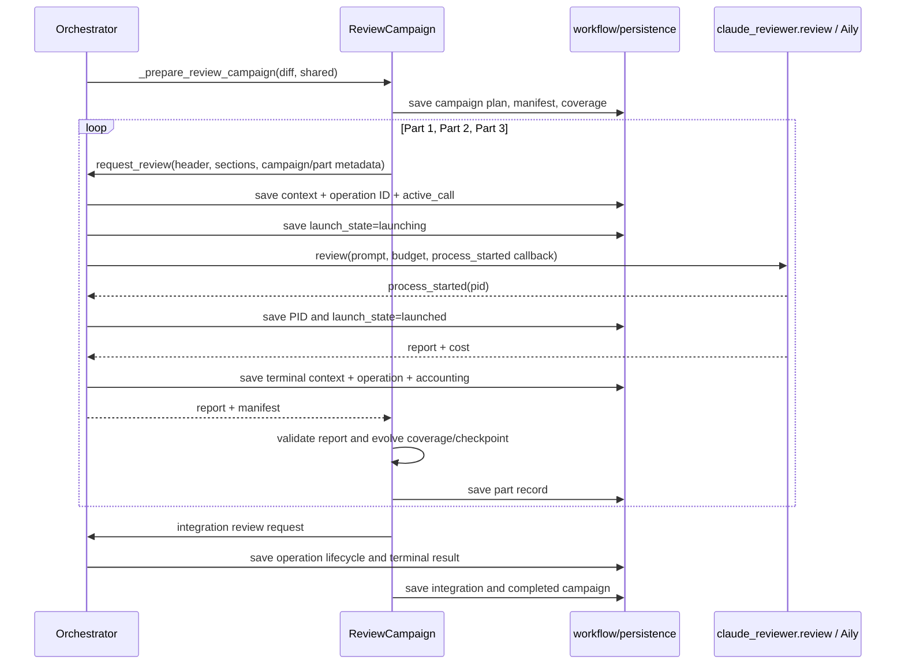
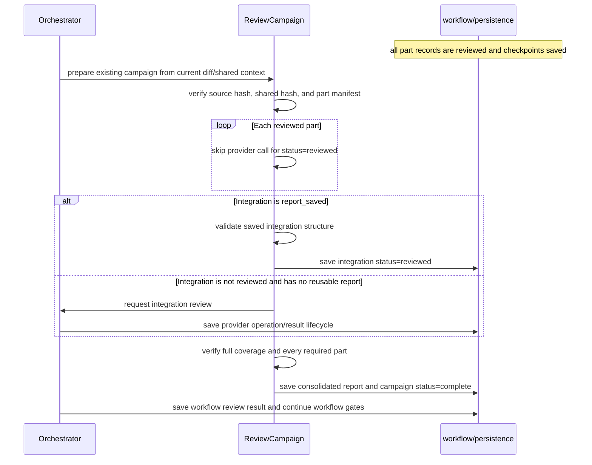

# Phase 3A — ReviewCampaign characterization

**Status:** Characterization complete; Phase 3B has not started.
**Repository:** `/Users/slcosentino/Documents/Preparacion/autonomous-engineering-harness-modular`
**Branch / HEAD at inspection:** `architecture/modular-v2` / `1afcb9e61e0ae7ed63ee2d06a15e90e4d143eb48`
**Scope:** Inspect current behavior, add recovery tests and documentation. No production behavior or state schema was changed.

## Executive findings

- **Verified:** `ReviewCampaign` in `harness/workflow/review.py` calculates partitions, prepares prompts, validates reports, evolves campaign records, tracks coverage, and coordinates per-part/integration checkpoints. It also receives the entire mutable workflow state and calls callbacks supplied by `Orchestrator` (`review.py::ReviewCampaign.__init__`, lines 589–628; `orchestrator.py::Orchestrator._review_campaign`, lines 3860–3869).
- **Verified:** `Orchestrator` remains authoritative for the workflow lock, authorization, budget, operation IDs/history, Claude context manifests, process identity, provider execution, durable saves, recovery resolution, and stage transitions (`orchestrator.py::_call_claude_impl`, lines 3420–3698; `Orchestrator._resolve_recovery`, lines 1409–1523).
- **Verified:** each part has its own checkpoint. A saved `reviewed` part is skipped; `report_saved` is structurally revalidated. A completed Claude context can also supply a report when the campaign checkpoint is still pending (`review.py::ReviewCampaign._run_review_campaign`, lines 1113–1261).
- **Verified:** a call whose result or final cost is unknown blocks later Claude/Aily calls and normal resume. A retry requires explicit reconciliation and creates another provider operation; this is not exactly-once execution (`orchestrator.py::_call_claude_impl`, lines 3637–3681; `Orchestrator._resolve_recovery`, lines 1470–1496).
- **Verified limitation:** normal saved-context fallback associates by campaign ID and part ID, completed call state, report presence, and whether the prompt hash is already in that campaign record. It does not reconstruct and compare the current prompt hash or verify that the context's operation ID joins to one matching operation-history record (`review.py::ReviewCampaign._run_review_campaign`, lines 1145–1181). The local recovery path performs broader prompt and report checks, but checks campaign call metadata consistency rather than repairing a missing campaign call checkpoint (`review.py::recover_review_campaign`, lines 1434–1605).
- **Inferred:** safe extraction requires an explicit snapshot-in/result-out campaign capability plus Coordinator-owned provider operations. Moving only the state dictionary would leave persistence, authorization, budget, and operation semantics implicit in callbacks.

## Current ownership and lifecycle

### Initialization

1. `Orchestrator._run_code_review_stage` builds the baseline-aware `ReviewDiff` through `_review_diff`, rejects an empty review scope, and creates the shared review context before campaign work (`orchestrator.py::_run_code_review_stage`, lines 4188–4240; `_review_diff`, line 437 onward; `workflow/review_input.py::build_review_diff`, lines 438–580).
2. `_code_review_shared_context` assembles assignment, proposal, implementation summary, repository/module context, skills, coverage context, and (for verification) correction material (`orchestrator.py::_code_review_shared_context`, lines 3700–3857).
3. `ReviewCampaign._prepare_review_campaign` creates a UUID campaign ID when there is no existing campaign, partitions the review segments, hashes source patches/exclusions and shared context, constructs a part manifest, records required call count, coverage, exclusions, and pending part/integration records, then calls `save_state` (`review.py::ReviewCampaign._prepare_review_campaign`, lines 894–1048; source hash and manifest, lines 855–893).
4. For an existing campaign it recomputes the source/shared hashes and part manifest and rejects changed inputs or a changed partition before paid calls. It also checks the saved call authorization against the Coordinator callback (lines 963–985).

### Review-part execution and layer ownership

| Step | Current owner | Evidence and behavior |
|---|---|---|
| Choose next part | `ReviewCampaign` | Iterates manifest order; skips status `reviewed`; revalidates `report_saved` or `invalid_report` (`review.py`, lines 1121–1181). |
| Construct part sections and prompt metadata | `ReviewCampaign` | Builds per-part sections and metadata including campaign/part IDs, shared/source hashes, payload limit, included/excluded paths (`review.py`, lines 1182–1209). `Orchestrator` builds shared context first. |
| Check campaign call-count authorization | `ReviewCampaign` calls `Orchestrator._review_call_count_authorized` | Callback counts previously used contexts and current campaign calls against the persisted maximum (`orchestrator.py`, lines 3860–3887). |
| Validate prompt sections and payload | `Orchestrator._call_claude_impl` | Redacts/formats input, validates required sections, payload length, persisted data scope, budget, and invocation limits (`orchestrator.py`, lines 3420–3600). |
| Create operation ID and operation/context records | `Orchestrator._call_claude_impl` | `_new_operation` records UUID, input prompt hash, cap, campaign/part/version and context index; context includes the operation ID (`orchestrator.py`, lines 933–998 and 3601–3627). |
| Persist before launch | `Orchestrator` | Saves the submitted context/operation and active-call record, then marks the operation `launching` and saves again (lines 3617–3629). |
| Start provider / persist process ID | Adapter and `Orchestrator` callback | Real `claude_reviewer.review` starts `Popen`, calls `process_started(pid)` before `communicate`, and the callback associates and persists the PID (`claude_reviewer.py::review`, lines 153–184; `Orchestrator._operation_process_started`, lines 1000–1007). Injected test callables may not use this callback. |
| Capture outcome and cost | `claude_reviewer.review`, then `Orchestrator` | Adapter decodes text/cost; Coordinator accounts cost or sets `budget_unknown`, updates the Claude context, and finalizes the operation (`claude_reviewer.py::review`, lines 204–217; `orchestrator.py::_call_claude_impl`, lines 3637–3698). |
| Validate report and persist part checkpoint | `ReviewCampaign` | Adds call metadata/report, validates exact part ID and file coverage, updates validation history and coverage, and saves (`review.py`, lines 1235–1261). |
| Enable next part | `ReviewCampaign` plus Coordinator policy | The next iteration runs only after the current call returns and the state is saved. Every next paid invocation passes through Coordinator budget/operation checks. |
| Integration and completion | `ReviewCampaign`, then `Orchestrator` | After all parts, creates integration input, executes or recovers integration report, validates it, then marks campaign complete and saves. Orchestrator stores final review and applies workflow gates (`review.py`, lines 1263–1432; `orchestrator.py::_run_code_review_stage`, lines 4241–4259). |

Atomic JSON persistence is implemented by `workflow/persistence.py::write_json` / `atomic_text` (lines 23–50). This makes a single state-file replacement durable at a boundary; it does not make the provider call and subsequent campaign checkpoint one transaction.

## Constructor dependencies, callbacks, and mutation inventory

| Dependency | Created by / contents | Mutable? | `ReviewCampaign` use and effects |
|---|---|---:|---|
| `state: dict` | `Orchestrator`'s loaded authoritative workflow JSON | Yes; shared object | Reads campaign, proposal version, and saved Claude contexts. Mutates campaign records and top-level coverage, exclusions, partition-failure, campaign ID/hash, and review-call-count fields. Mutations are persisted only when save callback is called. |
| `save_state` | Bound to `Orchestrator._save` | Callback | Persists the entire current workflow state under the held workflow lock; it is not a campaign-specific storage interface. |
| `request_review` | Bound to `Orchestrator._call_claude` | Callback | Indirectly enables validation, authorization, budget accounting, operation creation, provider call, process tracking, terminal result persistence, usage accounting, and recovery state. |
| `authorized_call_limit` | Read from saved `authorization.claude_aily.max_code_reviews` | Scalar | Recorded as campaign authorization context; not the full budget or authorization object. |
| `authorize_call_count` | Bound to `Orchestrator._review_call_count_authorized` | Callback | Reads all Claude contexts and saved call limit to decide if the campaign fits existing authorization. It cannot expand authorization. |
| `trace_span` | Bound to `Orchestrator._trace_span` | Callback | Opens optional trace spans; failures fall back to a null context. |
| `ReviewDiff` / shared context | Built by Orchestrator and review-input/workspace helpers | Data objects; shared context is a dict | Used to partition, hash, describe coverage, and render prompts. The campaign recomputes campaign hashes and part manifests. |

**Direct campaign mutations:** `review_campaign` and nested status/part/integration/report/call/validation/history/coverage fields; `review_campaign_id`; `review_shared_context_sha256`; `review_included_files`; `review_exclusions`; `review_files_not_reviewed`; `review_partition_failure`; and `review_campaign_call_count`. `_sync_review_coverage` also writes `state.review_files_not_reviewed` (`review.py`, lines 894–1100 and 1113–1432).

**Indirect state mutation:** `request_review` appends/updates `claude_contexts`, `operation_history`, `active_operation_id`, authorization spend/unknown state, resource usage, and error/recovery fields in the Orchestrator. The campaign relies on those records later for saved-context lookup. Its callback success value alone is not the whole provider contract.

## Persistence ordering and recovery state model

For a normal part, the current order is:

1. Campaign plan, part manifest, coverage, and authorization decision are saved.
2. Orchestrator builds/validates the prompt and creates the operation/context. The submitted context, `operation_id`, active-call record, and operation record are saved.
3. Operation state changes to `launching` and is saved.
4. With the real adapter, process ID is saved after process creation and before output collection.
5. Result text/cost are written to Claude context and terminal operation status is saved through `_finish_operation`.
6. Only after `_call_claude` returns does `ReviewCampaign` validate the report, append campaign call metadata, set report/status/coverage, and save the part checkpoint.

`Orchestrator._load` distinguishes `launch_state == "not_started"` from `launching`/running. The former can be marked safe to retry; the latter becomes recovery-required. A missing PID is recorded as `not_recorded`, not proof no process ran. When a PID exists, presence is only `present_unverified`, `not_running`, or `unknown`; identity is not established by PID presence (`orchestrator.py::_load`, lines 1622–1734; `_require_recovery`, lines 1351–1407). Process-group cancellation is best-effort in `workflow/process_control.py`, lines 21–80.

Unknown spend can arise from a caught provider failure without cost, a completed result without cost, or an interrupted call. `_call_claude_impl` sets `budget_unknown` and blocks future paid calls; `_resolve_recovery` requires the recorded interrupted operation, user-supplied verified cost, provider-inactive confirmation, and cost within operation cap and remaining workflow budget. Resolution is recorded on the old operation. Retrying later allocates a new operation ID. This is an explicit user-authorized retry that can repeat paid work; no exactly-once guarantee exists.

### Scenario A — Completed part and checkpoint present

- **Verified:** `status == "reviewed"` skips the part without another provider call. The report was structurally validated before its checkpoint; ordinary resume does not re-run that validation for already-reviewed parts (`review.py::ReviewCampaign._run_review_campaign`, lines 1121–1144 and 1235–1261).
- **Verified:** `_prepare_review_campaign` rejects a changed source hash, shared-context hash, or part manifest before further campaign calls (lines 963–985). This is the normal campaign-input guard. It protects source and partition identity, not integrity of arbitrary report/context/operation fields inside state.
- **Unknown:** the current tests do not directly mutate the saved campaign report while retaining `reviewed` and prove normal resume revalidates it; implementation shows it does not.

### Scenario B — Provider completed, campaign checkpoint absent

- **Verified:** normal resume searches saved contexts in reverse for matching `campaign_id`, `part_id`, `call_state == "completed"`, a report, and a prompt hash not already represented in the part's call list. It copies that report and validates its structure for the current part before saving the campaign checkpoint (`review.py::ReviewCampaign._run_review_campaign`, lines 1145–1181).
- **Verified limitation:** the path does not join `context.operation_id` to `operation_history`, compare `context.proposal_version` with the current proposal version, or reconstruct the current prompt to compare hashes. The campaign's source/shared/manifest checks still run first. The prompt hash currently acts as a de-duplication key, not proof that the saved prompt is the current request.
- **Verified:** local `recover_code_review` performs prompt/header/section/source/part/report/cost checks and does not invoke a provider, but requires a failed `code_review` workflow and rejects inconsistent saved-call metadata; it does not fill the missing campaign call record in this crash window (`orchestrator.py::recover_code_review` / `_recover_code_review`, lines 4623–4670; `review.py::recover_review_campaign`, lines 1434–1605).

### Scenario C — Provider launched, no terminal result

- **Verified:** `_load` sees a started operation with launch state other than `not_started` and enters recovery-required without replay. `process_id` may be absent or unverified; absence is not interpreted as no launch. Real Aily PID is captured before `communicate` (`orchestrator.py::_load`, lines 1653–1696; `claude_reviewer.py::review`, lines 157–184).
- **Verified:** interruption marks the Claude cost unknown, finalizes/interprets the operation as interrupted, and blocks default resume. A fake injected provider that raises `KeyboardInterrupt` exercises this behavior without a real provider (`orchestrator.py::_call_claude_impl`, lines 3655–3668).
- **Unknown:** whether the provider completed or incurred a charge when no terminal result was persisted. Process presence checks cannot establish provider-side completion.

### Scenario D — Unknown cost

- **Verified:** `budget_unknown` is stored under saved Claude/Aily authorization. Later Claude calls fail before provider execution; `ReviewCampaign` cannot proceed to later parts or integration (`orchestrator.py::_call_claude_impl`, lines 3430–3434; `ReviewCampaign._run_review_campaign`, lines 1193–1234).
- **Verified:** a valid reconciliation adds verified cost to spent budget, clears `budget_unknown`, stores resolution on the prior operation, and checks both `cap_usd` and total budget before retry (`orchestrator.py::Orchestrator._resolve_recovery`, lines 1470–1496).
- **Verified:** prior operation and contexts remain in history. The retry is a distinct operation.

### Scenario E — Explicit retry

- **Verified:** Claude retry requires a pending recovery for a Claude operation whose spend is unknown, a valid verified cost, and `confirm_provider_inactive=True`; the cost must be finite, nonnegative, within the prior operation cap, and fit remaining budget (`orchestrator.py::Orchestrator._resolve_recovery`, lines 1470–1496).
- **Verified:** normal resume with no recovery action blocks. After valid explicit retry, the same saved stage continues. The old operation's resolution remains in operation history; the new provider invocation receives another ID (`orchestrator.py::_resume_locked`, lines 2794–2813; `_new_operation`, lines 933–998).
- **Verified limitation:** a retry may duplicate provider work and charges if the old provider completed but its result was lost. No provider idempotency key or provider-result lookup is present in this flow.

## Recovery sequence diagrams

The labels below describe current V2 behavior, not a proposed architecture.

### 1. Normal three-part review



**Verified:** sequence from `ReviewCampaign._prepare_review_campaign` / `_run_review_campaign`, `Orchestrator._call_claude_impl`, `claude_reviewer.review`, and `_save`/`workflow/persistence.write_json` (citations above). **Inferred:** a process crash can occur between any two saves. **Unknown:** durability across filesystem/device failure beyond the atomic file replacement primitive.

### 2. Part 1 checkpointed; Part 2 unresolved; Part 3 pending

```mermaid
sequenceDiagram
    participant O as Orchestrator
    participant C as ReviewCampaign
    participant P as workflow/persistence
    participant A as claude_reviewer.review / Aily
    Note over C,P: Part 1 report and status=reviewed already saved
    C->>O: request Part 2
    O->>P: save operation/context, then launch_state=launching
    O->>A: start Part 2
    A-->>O: PID callback when available
    O->>P: save process identity
    Note over A,O: interruption before reliable terminal result
    O->>P: save interrupted operation, budget_unknown, recovery_required
    Note over C: Part 2 checkpoint remains pending; Part 3 has no operation
    O->>O: default resume detects recovery_required
    O-->>C: no campaign replay; error returned
```

**Verified:** `test_three_part_uncertain_campaign_call_requires_explicit_retry` establishes preserved Part 1, pending Part 2/3, no automatic new operation, and explicit retry history. **Inferred:** with the real adapter, PID persistence can precede the interruption. **Unknown:** provider completion/cost without terminal result.

### 3. Provider result saved; campaign checkpoint missing

```mermaid
sequenceDiagram
    participant O as Orchestrator
    participant C as ReviewCampaign
    participant P as workflow/persistence
    participant A as FakeClaude / provider adapter
    C->>O: request Part N
    O->>P: save submitted context + operation
    O->>P: save launch state
    O->>A: invoke review
    A-->>O: completed report + cost
    O->>P: save completed context/report + completed operation
    Note over O,C: crash before ReviewCampaign records report/calls/status
    Note over P: saved campaign part is still pending
    O->>C: resume saved code_review stage
    C->>P: find completed context by campaign ID + part ID + call state
    C->>C: de-duplicate by prompt hash; validate report against part manifest
    C->>P: save reconstructed campaign checkpoint
```

**Verified:** `test_completed_review_report_recovers_when_campaign_checkpoint_is_missing` exercises the crash boundary and confirms no second call. **Verified limitation:** normal fallback does not compare a reconstructed prompt hash or operation-history join. **Not currently supported:** using this path as evidence that operation ID, proposal version, and exact input identity were validated.

### 4. Unknown cost, reconciliation, explicit retry

```mermaid
sequenceDiagram
    participant U as User
    participant O as Orchestrator
    participant P as workflow/persistence
    participant A as FakeClaude / provider adapter
    O->>P: save Claude operation and submitted context
    O->>P: save launch_state=launching
    O->>A: invoke review
    A--xO: interruption; no trustworthy terminal result/cost
    O->>P: save interrupted operation + budget_unknown + recovery
    U->>O: normal resume
    O-->>U: blocked; explicit recovery action required
    U->>O: retry + verified cost + confirm provider inactive
    O->>O: validate operation, cost cap, remaining budget
    O->>P: save cost resolution on old operation; clear budget_unknown
    O->>P: create and save a new operation ID
    O->>A: invoke the saved stage again
    A-->>O: report + retry cost
    O->>P: save retry result; retain old operation history
```

**Verified:** `test_three_part_uncertain_campaign_call_requires_explicit_retry` covers missing confirmation, cost above cap, default resume blocking, a valid retry, new operation identity, and preservation of the old operation. **Verified limitation:** a retry may repeat a paid call; operation history is audit history, not an exactly-once mechanism.

### 5. Resume after all review parts are complete



**Verified:** reviewed parts are skipped and integration is independently completed or recovered (`review.py::ReviewCampaign._run_review_campaign`, lines 1121–1144 and 1277–1432). **Inferred:** if all part/integration checkpoints were complete before interruption, resume reaches the completion gate without another provider call. **Unknown:** no dedicated test currently simulates a process stop after every review checkpoint is complete but before stage advancement.

## Existing test coverage and gaps

| Test | What it proves | What it does not prove | Phase 3A action |
|---|---|---|---|
| `test_large_review_uses_adaptive_parts_shared_context_and_integration` | Adaptive multipart partition, shared context, complete file coverage, integration call, call and cost counts. | Crash recovery across three parts, or missing checkpoint association. | Keep; no duplicate. |
| `test_resume_reuses_successful_parts_and_retries_only_failed_part` | A completed part is reused after a later known-cost `ReviewError`; failed part is called again. | Uncertain launched operation, unknown spend, three-part pending tail, or explicit recovery conditions. | Add uncertain three-part test. |
| `test_saved_part_report_is_recovered_without_repeating_paid_call` | A normal `WorkflowError` enters ReviewCampaign's exception handler, which saves `report_saved`; later resume validates/reuses it. | Crash before campaign catches/saves the report, operation-ID join, or exact prompt reconstruction. | Add missing-checkpoint test. |
| `test_saved_integration_report_is_recovered_without_repeating_paid_call` | Caught integration boundary saves and reuses integration report. | Process death with no integration campaign checkpoint. | Existing scope retained; document gap. |
| `test_unknown_part_spend_blocks_all_later_campaign_calls` | A returned report with unknown cost prevents subsequent parts/integration and resume. | Provider launched but no terminal result; it asserts a completed callback return with `cost=None`. | New uncertain test covers launch/interruption gap. |
| `test_interrupted_claude_call_marks_cost_unknown_and_is_not_repeated` | Interrupted planning Claude call blocks default resume. | ReviewCampaign part position, checkpoint preservation, retry history. | New uncertain campaign test. |
| `test_interrupted_claude_retry_requires_verified_cost_and_stays_within_budget` | Planning-stage retry needs cost/inactivity confirmation and obeys cap/budget. | Campaign operation ID, part report, and prior campaign history. | New campaign retry coverage. |
| `test_invalid_part_report_cannot_complete_campaign_or_omit_files`; `test_part_report_requires_each_assigned_file_in_files_reviewed_section` | Invalid/missing coverage report cannot mark part/campaign complete. | Revalidation of already-`reviewed` state after arbitrary persisted-state corruption. | Document trust boundary. |
| `test_local_recovery_dry_run_revalidates_reports_without_writing_or_calling_provider`; `test_local_recovery_apply_is_auditable_idempotent_and_preserves_call_costs` | Local recovery is provider-free and has an auditable apply path. | Normal resume recovery semantics; local apply is a separate command/path. | Keep distinct. |
| `test_local_recovery_rejects_changed_target_diff_without_mutation` | Local recovery rejects a changed source diff. | Normal resume's campaign hash guard as a separate regression. | Existing implementation guard is documented; test gap remains. |
| `test_operation_and_pid_are_persisted_before_codex_result_finalization` | Operation/PID ordering for Codex executor. | Equivalent Claude campaign ordering. | Lifecycle verified from code; a focused Claude ordering test remains a possible later addition. |
| `ReviewCampaignBoundaryTests.test_campaign_runs_through_state_and_provider_callbacks_without_orchestrator` | ReviewCampaign can be invoked without an Orchestrator instance when given shared state/callbacks. | A narrow independent capability, state ownership separation, or coordinator-free policy. | Do not treat as proof of independence. |

### Tests added in Phase 3A

- `WorkflowTests.test_three_part_uncertain_campaign_call_requires_explicit_retry`: uses a fake Claude callable and temporary target; proves Part 1 remains completed, Part 2 is uncertain, later parts remain pending, default resume adds no operation, reconciliation checks are enforced, explicit retry gets a new operation ID, and old operation history remains.
- `WorkflowTests.test_completed_review_report_recovers_when_campaign_checkpoint_is_missing`: interrupts after the fake provider result and operation/context terminal save but before the campaign part save; an intervening target edit is rejected by the write-operation fingerprint gate without another call, then restoring the source allows resume to recover the exact report without a second provider call.
- The second test also documents the current scope of that proof: it verifies the context is found through the current persisted campaign/part association and prompt-hash call record, but it cannot claim production validates operation-history join or reconstituted prompt identity because current code does not do so.

## Proposed future capability boundary

This is a Phase 3B recommendation, not current behavior.

| Responsibility | Future owner | Reason |
|---|---|---|
| Baseline/source patch, exclusions, review scope and source hash | Review input/workspace capability | Requires target/Git/snapshot access and safe path attribution; keep I/O outside campaign state evolution. |
| Shared context gathering | Coordinator plus repository-context capability | Depends on proposal, implementation evidence, guidance, skills, and target inventory. A pure renderer can receive those as explicit text. |
| Segment calculation, adaptive partitioning, part manifest, coverage, next-part choice | ReviewCampaign capability | Deterministic calculations from explicit diff/context and persisted campaign snapshot. |
| Part/integration prompt assembly | ReviewCampaign or a small review-request builder | Pure formatting from explicit campaign/part/context inputs; must return prompt and input hashes together. |
| Report parsing/validation | Review report capability | Pure validation from report, part ID, and immutable assigned segment manifest. |
| Campaign snapshot evolution | ReviewCampaign capability | Return a new campaign snapshot and next action; do not mutate authoritative workflow state. |
| Authorization, budget, provider operation IDs/history, launch/PID/terminal saves, retries, recovery state, workflow transitions | Orchestrator/Coordinator | Cross-stage policy and authoritative side effects; must remain in one owner. |
| Claude/Aily transport and process identity callback | Provider adapter/executor | Execute one already-authorized immutable request and return normalized outcome; no workflow policy. |
| Atomic serialization | Persistence module called by Coordinator | Persists coordinator-owned state under existing lock; campaign capability does not save state. |

**Minimum immutable inputs:** campaign snapshot/version; campaign ID and purpose; ordered `ReviewDiff` source patch/exclusion/context hashes and immutable part segments; shared-context values or their stable snapshot; proposal version and explicit proposal hash; payload limit; report contract version; and any prior call summaries required for deterministic next-action selection. No target path, Orchestrator object, mutable workflow state, provider, or save callback should be required by the pure campaign decision function.

**Minimum result:** an immutable transition containing the evolved campaign snapshot, next action (`request_part`, `request_integration`, `complete`, or a typed blocked/invalid result), exact request payload/metadata and hashes when a call is needed, plus validation/coverage findings. Coordinator validates authorization, creates/persists the operation, calls the adapter, persists the result, then supplies that result back for the next pure transition.

## Risks and unresolved questions for Phase 3B

1. Define whether a saved report can be reused only after operation ID, proposal version, prompt hash, header/section hashes, cost, and campaign source all match reconstructed current input. Current normal fallback checks only a subset.
2. Decide whether a campaign transition should model provider calls as requested/result events, so persistence order is visible and replay decisions can be tested without a provider.
3. Keep the distinction among `report_saved`, `reviewed`, `invalid_report`, `call_failed`, and uncertain launched operations; each has different retry and validation semantics.
4. Preserve atomic campaign snapshots without weakening the Coordinator's state lock or operation audit trail.
5. Define explicit expectations for corrupted persisted state. Normal resume trusts `reviewed`; local recovery has stronger checks but its preconditions and call-metadata comparisons differ.
6. Retain the honest delivery claim: recovery prevents automatic replay of uncertain calls but cannot ensure exactly-once external execution.

**Phase 3B preconditions:** approve the state/result contract; decide the missing identity joins/validation requirements; add focused characterization tests for reviewed-state tampering, complete-checkpoint resume, and operation/prompt association; then move only pure deterministic rules first. Do not combine that work with Coordinator relocation or provider/authorization policy changes.
